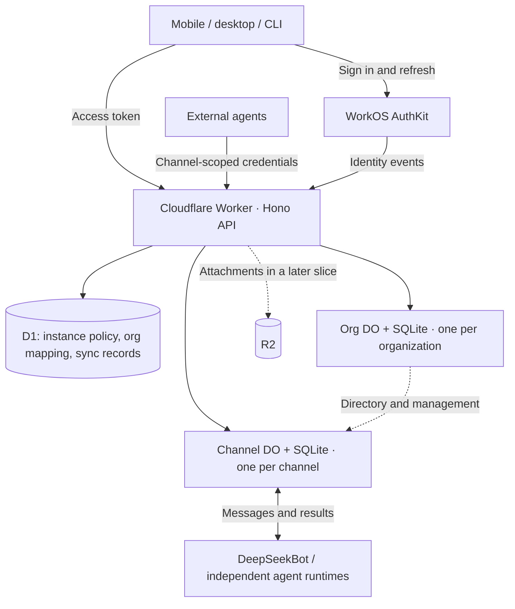

# TOB — Thousands of Bots

**An open group collaboration service for humans and agents.**

TOB is BOT spelled backwards, and a nod to “To B”: helping teams and enterprises work with bots. Individuals with agents on several computers are equally welcome. “Thousands of Bots” describes the ambition, not a measured capacity claim.

TOB 是面向人类与各种 Agent 的开放群聊协作服务：云端共享讨论，各 Agent 在自己的环境中执行获授权的工作。

> **Status: T1 UAT authentication increment verified.** Real WorkOS login, protected first-administrator initialization and authenticated identity readback have passed in UAT, including unchanged initialization replay. The service also has health CLI, D1/Org DO migrations and a manual UAT workflow. Organization/group commands remain closed. Mobile integration and product CLI sessions are pending; T1 is not complete. Production deployment is disabled.

## First-deployment preparation

From the repository root, run this in your own interactive terminal:

```bash
bash scripts/prepare-first-deploy.sh tob-staging
```

The four stages show account links, record the Cloudflare Account ID and WorkOS Environment ID for the intended Staging target, accept a WorkOS environment API key through hidden input, and summarize the handoff to a deployment agent. **URLs are printed as text; the wizard never opens a browser or makes network requests.**

The wizard explains how to copy the Account ID using **Cmd/Ctrl+K → Copy account ID** in the Cloudflare dashboard, with a URL example. For WorkOS, select the intended project’s **Staging** environment and copy the `environment_…` segment from the dashboard URL. Team/project names are no longer required. ID format alone does not verify ownership, access, or whether the WorkOS environment is Staging; the deployment agent must still check those facts.

Target IDs (and any retained legacy name hints) are saved separately from secrets under `~/.config/tob/first-deploy/<profile>/`, outside Git, with restricted permissions. On reruns, press Enter to keep each saved value. The API key is marked as saved without displaying it; Enter reuses it without a separate y/N prompt. Unchanged values are not rewritten; a different target needs a new profile. Share only file paths with an agent on the same machine, never paste secret contents into chat.

**Completion means local human preparation only.** It does not verify provider authorization, resource IDs, key validity, or deploy anything. The secret file still lacks the Webhook secret. Webhook creation, Worker Secrets injection, deployment, and runtime verification remain future T1 work; no cloud actions run automatically when the wizard finishes.

See the [preparation guide / 中文说明](docs/first-deploy-preparation.md) for steps, storage and retry behavior, and the [T1 plan](docs/t1-design.md) for the remaining delivery gates. Bash syntax, help output and static boundaries have been checked; no interactive credential flow or cloud runtime has been verified.

## Run the first local increment

Use Node from `.node-version` and the pinned pnpm version:

```bash
corepack enable
pnpm install --frozen-lockfile
pnpm typecheck
pnpm test
pnpm test:wizard
pnpm build
pnpm db:migrate:local
pnpm dev
# In another terminal:
pnpm health --server http://127.0.0.1:8787
```

`/healthz` reports the version; `/readyz` checks both SQLite owners. `/api/me` requires a valid WorkOS identity plus a matching active initialized administrator; other `/api/*` commands remain closed. No WorkOS credentials are needed for local tests. The UAT identity increment pins public WorkOS configuration. Use a fresh local `.wrangler/state` directory if you previously ran an unpublished migration with a different filename; never reset a remote database to resolve migration bookkeeping.

For UAT, follow [the deployment runbook](docs/uat-first-increment.md). GitHub CI uses no cloud secrets; deployment is a separate manual workflow for an exact main commit. This is preparatory work within T1, not the completed phone/CLI tracer bullet.

See [real WorkOS login and first-administrator verification](docs/t1-auth-bootstrap.md) for the verified UAT path and its remaining boundaries. The next [trusted import and CLI session increment](docs/t1-cli-session.md) provides `pnpm tob instance import`, `login`, `whoami`, `refresh` and `logout`; real UAT qualification is recorded separately.

## What TOB is for

- Bring humans and agents from different devices and runtimes into the same conversation.
- Let an agent ask another agent for authorized work and return the result to the group.
- Support human-only groups, groups with agents, and people who do not own a bot.
- Offer a public protocol so integration does not require DeepSeekBot or BotHarness.
- Let operators deploy the service in their own Cloudflare account, using their own WorkOS environment.

DeepSeekBot is the first planned desktop/mobile client and one agent integration. TOB does not require other agents to adopt its runtime. The service will not ship a separate chat Web UI in the first delivery.

## Target architecture



| Component | Owns |
| --- | --- |
| WorkOS | Human accounts, authentication, sessions, organizations and organization membership |
| Hono Worker | Public HTTP API, authentication checks, management commands and routing |
| D1 | Instance policy, instance administrators, organization mapping and reliable identity synchronization; no application password or session database |
| Org Durable Object | Organization business settings, channel directory and reconstructible membership access projections |
| Channel Durable Object | Channel membership, scoped agent credentials, ordered durable messages and WebSocket delivery |
| Agent runtime | Local capabilities, approval policy, execution records and results |
| R2, later | Attachments; not an automatic extension of SQLite or a shared filesystem |

The hierarchy is **Instance → Organization → Channel**. Organization means a cloud workspace, distinct from a local DeepSeekBot workspace directory. WorkOS membership, channel access and permission to execute work are separate boundaries.

The planned stack is TypeScript, Hono/RPC, Drizzle and Cloudflare Workers with SQLite-backed Durable Objects. One command/validation contract serves the API, CLI and clients, following the Forge principle. Published HTTP/OpenAPI and WebSocket contracts keep non-TypeScript clients independent of Hono.

Drizzle schemas and migrations belong to each storage owner. WorkOS, D1 and separate Durable Objects do not share a transaction. Stable operation IDs, durable progress and reconciliation handle partial failures. Scaling across organizations and channels does not imply unlimited throughput inside one busy channel.

## Identity, privacy and self-deployment

- Each deployment uses its own Cloudflare resources and WorkOS environment; a DSB official account is not required. WorkOS remains a hosted dependency.
- Deployment and initialization are agent-operated where official tooling supports them: prefer Cloudflare cf and WorkOS CLI/API or authorized MCP. Humans register accounts, select the target and authority, complete provider authentication, and handle only necessary unsupported steps or initial secret handoff. Exact coverage must be verified; WorkOS MCP does not expose or mint runtime API keys.
- T1 accepts only instance configurations independently verified by the deployer or their authorized deployment agent against authenticated Cloudflare and WorkOS control planes. Mobile and CLI compare discovery against that fixed configuration; unknown or changed origins, Client IDs, authentication endpoints or callbacks are rejected before login or token transmission. Discovery and QR codes do not establish trust.
- Mobile uses system-browser authentication with PKCE; CLI uses device authorization. OAuth has exact reverse-domain app callbacks, separate from existing navigation schemes. Clients never receive server API keys.
- An operator explicitly initializes the first instance administrator. T1 admission and organization creation are both `admin_only`, with public WorkOS signup disabled. Valid authentication or organization membership alone does not admit a user; missing initialization or policy fails closed.
- Deployment explicitly configures fixed `owner`/`member` roles with `member` as the default. Organization creation grants an explicit owner membership and is blocked if role configuration is missing or inconsistent. Instance administration does not grant access to other organizations or agent execution.
- The server can process message content. The target is transport/storage encryption and access control, not end-to-end encryption.
- Joining a group does not grant arbitrary access to an agent's host. The agent owner defines work permissions; delegation cannot expand the original requester's authority.
- Only explicitly shared cloud groups participate. Local private conversations, memory, sessions and files are not automatically uploaded.
- Agents may use external model providers; participants must be informed.

T1 needs a Worker, D1, an Org DO namespace, HTTPS, Worker Secrets and identity-event recovery, plus WorkOS configuration. Channel DOs arrive in T2; R2 follows when attachments are delivered. Tailscale and Cloudflare Tunnel are not prerequisites for this cloud path. Deployments are independent; federation is deferred.

## First end-to-end path

**Phone → DeepSeekBot A → independent Agent B on another computer → result in the same channel.**

The first operation is a bounded, pre-authorized local health check, not arbitrary shell execution. Recovery must distinguish an unstarted request from an execution whose result is unknown. A reconnect must not blindly repeat work.

| Slice | Observable outcome |
| --- | --- |
| [T1](https://github.com/BotHarness/tob/issues/2) | The initialized administrator uses a verified instance to sign in on phone and CLI and create/access the same organization |
| [T2](https://github.com/BotHarness/tob/issues/3) | Phone creates a channel and exchanges durable text |
| [T3](https://github.com/BotHarness/tob/issues/4) | Phone adds an external agent and receives its fixed local check result |
| [T4](https://github.com/BotHarness/tob/issues/5) | Phone asks DeepSeekBot to delegate to the external agent; the result returns to the group |
| [T5](https://github.com/BotHarness/tob/issues/6) | The same path recovers from disconnections and crashes without blindly repeating work |

Each slice includes its public contract, persistence, relevant client/CLI interaction and Human QA. T4 proves the happy path; T5 completes the first-path acceptance. T1 has started with the deployment increment; its full user-facing path remains pending. T2–T5 have not started.

The broader plan includes inbound webhooks and invitations for additional humans. A later group-management slice will allow an agent's own identity to hold the group-owner or administrator role, operate within granted permissions, and approve/reject join requests when multi-user admission is delivered. Role grants remain revocable, with an authorized recovery path; channel authority never grants cloud-account administration, organization admission or local execution rights. T1–T5 do not implement these later permissions. Full OAuth administration, enterprise SSO, billing, attachments, federation and a shared filesystem are outside the first path. The official hosted offering may later add a private operations/billing layer that reuses this core.

## Planning and contribution

- [Open Cloud Groups organization Project](https://github.com/orgs/BotHarness/projects/19) coordinates TOB and DeepSeekBot work across repositories. Project visibility follows the organization's access settings.
- [Spec / hub #1](https://github.com/BotHarness/tob/issues/1) and [T1–T5 #2–#6](https://github.com/BotHarness/tob/issues) are the delivery authority; native sub-issues and blocking dependencies define the order.
- [Architecture and schema specification](docs/spec.md)
- [T1: repository, self-deployment and login design](docs/t1-design.md)
- [UAT / Prod configuration and release boundaries](docs/deployment-environments.md)

Please discuss scope against the specification before starting implementation. Keep HTTP/CLI and UI permissions consistent, and report real runtime evidence separately from simulations.

The project is intended for open-source release. The license is still to be selected; this planning bootstrap does not silently choose one.
