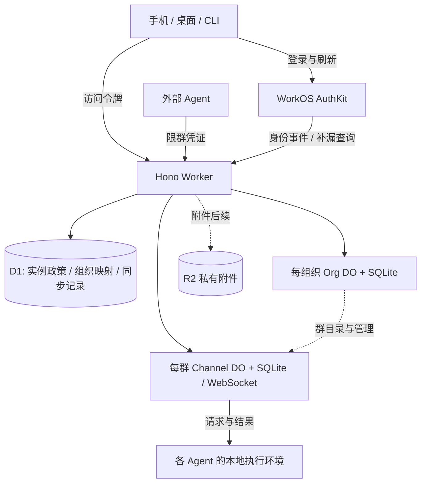

# TOB — WorkOS architecture and first heterogeneous-agent path

Canonical delivery specification: https://github.com/BotHarness/tob/issues/1

状态：已授权启动 T1 的最小本地增量并配置、验证 UAT 部署。当前已实现健康/版本、D1 与 Org DO 迁移、关闭的业务入口及手动 UAT 工作流；完整手机/CLI 认证与组织路径仍待实现，T1 未完成，T2–T5 与 Prod 未启动。首个 UAT 部署与同 SHA 重跑已通过，证据见 [首个增量运行记录](uat-first-increment.md)。

已单独授权交付 [首次部署人工准备向导](https://github.com/BotHarness/tob/blob/main/scripts/prepare-first-deploy.sh) 与 [说明](https://github.com/BotHarness/tob/blob/main/docs/first-deploy-preparation.md)：仅本机步骤引导、目标记录与隐藏输入 API key。准备完成不代表控制面授权、凭证核验、Worker Secrets 注入或部署完成；该向导本身仍只做准备；当前服务增量范围见上述运行记录。

## Problem Statement

一个 Human 的 Agent 分布在不同电脑和运行时中，缺少同一个手机群聊入口来协作。依赖某台 Host 在线或外部聊天镜像，会限制独立 Agent 接入与自部署。用户需要开放的群服务，手机可直接管理并参与群聊，工作仍在各 Agent 的环境内按主人授权执行。

## Solution

独立开源服务提供组织业务、群权限、公开消息协议及 CLI。WorkOS 管登录、账号和组织身份，Cloudflare 管群协作。DeepSeekBot 桌面与现有 Expo App 提供界面，外部 Agent 无需 DSH/BotHarness。

首个交付目标：手机登录自己的实例并创建群 → 接入 Mac 上的 DeepSeekBot A 与另一电脑的独立 Agent B → 手机 @A → A 向 B 转交预授权本机检查 → B 回报同群 → 手机看到结果。随后验证断线补历史、撤权和不重复工作；结果不明时明确报告。

T1 的入口限定为部署者独立核验过的实例，且只有已初始化的 active 实例管理员能进入业务和建组织；后续切片不自动放开此限制。

首条路径只是完整 MVP 的第一部分。本规格不把企业 SSO、auth.md、自建网盘或收费作为其前提。

## User Stories

1. As an 实例部署者, I want 在自己的 Cloudflare 账号部署独立服务, so that 不依赖官方托管账号。
2. As an 实例部署者, I want 受保护的管理员初始化与恢复入口, so that 公网访问者不能抢占实例。
3. As an 已初始化实例管理员, I want 从可信部署电脑扫码导入公开连接配置，并在 CLI 读取同一配置文件, so that 在 T1 连接部署者已核验的实例。
4. As a Human, I want 通过该实例配置的 WorkOS 登录手机, so that 不需要先配对一台本地 Host。
5. As a Human, I want 凭证和缓存按实例及身份隔离, so that 切换服务不会混用账号或消息。
6. As a Human, I want 在被允许时创建自己的 Organization, so that 群和成员有清晰归属。
7. As an 获授权组织成员, I want 用手机创建 Channel, so that 初次配置不依赖桌面端。
8. As a Human, I want 发送文本、选择 @目标并读取持久历史, so that 在线与断线后的讨论保持连续。
9. As a Human, I want 看到待发送、已提交和工作结果的区别, so that 不把收到消息当成执行成功。
10. As a 群管理员, I want 在手机创建并撤销限群的 Agent 凭证, so that 外部运行时能独立接入。
11. As an Agent 作者, I want 通过 HTTP 和主动连接的 WebSocket 使用群协议, so that 不需要公网接收端或 DSH 依赖。
12. As an Agent 作者, I want 可运行的参考程序, so that 能复现认证、收发、补历史和结果回报。
13. As a Human, I want 分辨重名 Agent 的身份及执行环境, so that 不会请求错误的电脑。
14. As a Bot 主人, I want 显式把本地 Bot 接到指定云群, so that 本地私聊、Memory 和文件不会自动上传。
15. As a Human, I want 手机 @DeepSeekBot 后由它转交给另一 Agent, so that 可以在一个群内完成跨设备协作。
16. As a Bot 主人, I want 转交保留原始请求人和权限上限, so that 代理关系不会扩大工作权限。
17. As a Bot 主人, I want 固定本机检查只有预授权请求才能触发, so that 入群不等于任意 shell 或文件访问。
18. As a Human, I want Agent 离线时仍可使用云群, so that 手机聊天不依赖电脑在线。
19. As a Human, I want 重试和重连不会重复启动同一请求, so that 网络故障不会重复工作。
20. As a Human, I want 过期、撤权和结果不明有明确状态, so that 可以判断是否需要重新授权或人工核对。
21. As a 群管理员, I want 撤销凭证阻止已有连接继续读写, so that 撤销实际生效。
22. As an 组织成员, I want 其他组织和非成员无法访问本群, so that 服务端保护组织及群边界。
23. As a CLI 用户, I want 所有本切片管理能力都有相同权限的命令, so that 无需 UI 或模型也能操作和验证。
24. As a Human, I want 知道服务端可处理正文且 Agent 可能调用外部模型, so that 理解内容的实际处理边界。
25. As an 维护者, I want 验证 WorkOS 登录、刷新与现有连接撤权, so that 托管身份与本地群权限保持一致。

## Implementation Decisions

### 1. 仓库、平台与身份

- 开源服务独立仓库：Hono API/RPC、HTTP/OpenAPI 与 WebSocket 合同、Worker/DO 业务、Drizzle、CLI、参考 Agent 和部署说明。Forge 采用同一命令合同派生多入口的架构；不复制 UI/CLI 业务权限。具体生成器接入随首条命令验证。
- DeepSeekBot 仓库：现有 Host Messaging 适配、桌面绑定入口、现有 Expo App。服务本身不提供聊天 Web UI。WorkOS 托管登录页面与必要回调不属于独立聊天 UI。
- 私有官方运营仓库后续只处理托管运营与收费，复用开源权限和消息服务。公开仓库已确认为 BotHarness/tob（TOB — Thousands of Bots），许可证待定；规格与任务迁入 TOB tracker，组织级 Open Cloud Groups Project 同时关联 TOB 与 DeepSeekBot。
- Instance → Organization → Channel。Organization 就是云端工作区，不等于 DSH 本地 Workspace。用户可以属于多个组织；应用层 org_id 映射到该实例 WorkOS organization_id。
- WorkOS 是用户、会话、组织成员、组织角色及身份邀请的权威。应用不另建密码/会话数据库，不继续实现 Better Auth 或 Auth DO。之前 Better Auth 的 DO/D1 探针是历史调研，不再阻塞当前路线。
- 自部署使用部署者自己的 Cloudflare 账号和 WorkOS 环境/密钥。不需要 DSB 官方账号；但需要连接 WorkOS 云服务。这明确替代早期“自部署免外部身份服务”的假设。

### 2. 第一条路径的身份与部署合同

- T1 只接入部署者独立核验过的实例。部署者或其已授权的部署 Agent 从已认证的 Cloudflare 与 WorkOS 控制面核对并预先固定 API HTTPS origin、WorkOS Client ID、issuer/认证端点与移动回调的组合；不能仅凭目标实例返回的 discovery 或二维码完成核验。手机和 CLI 只使用该已核验组合，未知地址或配置不匹配时在发起登录前拒绝，不向它发送 token；关键配置变化须重新核验。公开发现仅检查兼容性与一致性，不建立信任。任意陌生实例即插即用不属于 T1。
- 可信配置交付固定为一份公开连接配置、两种入口：部署 Agent 核验后生成 `tob-instance.json` 与包含同一配置全文的本地二维码；手机“添加云服务 → 扫描部署二维码”，CLI `tob instance import ./tob-instance.json`。配置包含格式版本、实例 ID/显示名称、API HTTPS 地址、WorkOS 公共 Client ID/已核验认证配置及已登记移动回调，不含秘密、用户身份或权限。二维码不通过下载链接取得配置，详细云资源 ID/核验记录留在部署者本机。
- 首次导入的信任来自用户从自己的可信部署电脑取得配置；手机不能独立证明控制面核验曾发生，也不信任二维码内自称“已核验”的字段。客户端先本地校验、展示域名/环境并确认，再无凭证读取 discovery 比对，通过后保存并单独登录。任意陌生二维码不因此可信；手动输入地址只选择已导入实例。导入不授予实例管理员或群权限。
- 登录、刷新和重新连接前检查固定配置与 discovery 一致性；不跟随重定向把凭证送到新地址。关键配置不匹配即停止该实例联网操作，部署 Agent 重新核验两个控制面并生成文件/二维码；客户端展示差异、确认替换后使本机旧登录事务与会话绑定失效，再重新登录。旧 token 不转交新目标，其他设备分别更新，不自动迁移旧缓存或待发送内容。
- 名称仅更新展示；Worker 升级或服务端密钥轮换且公开配置不变，不要求重新导入。API 地址、Client ID、issuer、认证端点或回调变化必须重新核验；实例 ID 变化当作新实例。网络故障保留原配置并显示暂时无法核验，配置不匹配显示需要重新导入，没有忽略后继续入口。T1 不增加配置签名、信任注册中心、自动更新订阅或配对服务器。全部为已确认设计，尚未实现。
- 部署初始化以 Agent 通过 CLI/API 代办为默认路径：Cloudflare 优先使用 cf，WorkOS 优先使用 CLI，已授权且具备相应操作的 MCP 也可使用。Human 负责账号注册、选择目标账号/环境及管理员身份、供应商登录/OAuth/必要身份验证；授权范围内的配置和检查不逐项再要求人工确认。部署 Agent 不因此成为 TOB 的独立实例管理员，T1 的 Human admin_only 业务准入保持不变。
- 自动化必须记录工具版本、目标账号/环境、已完成步骤与必要人工项。Cloudflare cf 仍为 beta；具体 bindings、迁移、Secrets、Cron 与 WorkOS 操作覆盖须在 T1 实测。CLI/MCP 暂未支持的开关或秘密交付明确交给 Human，完成后读回核验；不能静默跳过，也不以自动安装器创建的临时环境代替部署者自有环境。
- WorkOS MCP 不提供创建/轮换 API keys 等敏感凭证，返回秘密会被剥离；首次环境 API key/事件签名秘密的安全交接仍待验证。关闭注册、单角色/默认角色及回调已有真实 MCP 读取和管理合同证据，但持久化设置尚未执行。必要秘密经本机私密文件/凭证存储交给部署工具，避免进入模型上下文、普通输出或公开记录。不承诺仅注册和 OAuth 足以完成全部步骤，也不新增平台代管层。
- 手机保持系统浏览器 Authorization Code + PKCE，CLI 保持设备授权；不增加认证中转、第二种 Human 会话、DPoP 或自动实例登记机制。手机 OAuth 专用回调定为 `ai.botharness.deepseekbot:/oauth2redirect`，开发版为 `ai.botharness.deepseekbot.dev:/oauth2redirect`，分别精确登记；现有 deepseekbot 导航 scheme 不作为新的 OAuth 回调。state、verifier、已核验实例及回调绑定为一次性事务，仍须真实原生构建验证。
- 首条路径只启用一种 WorkOS 托管登录方式，建议邮箱密码；CLI 采用受支持的设备授权/浏览器确认流程。不自行接收用户密码来绕过登录。邮箱 OTP、Google、完整登录配置管理保留后续切片；用户名别名不是首片前提。
- WorkOS 默认邮件替代原 Cloudflare 发 OTP 的默认假设；若后续仍要求 Cloudflare 发信，单独验证自定义邮件集成。当前不配置或发送邮件。
- 首个应用用户由部署者指定目标邮箱，在 WorkOS 关闭公开注册并读回后，取得无 Organization/角色的应用邀请。本人接受并认证后，部署 Agent 按 invitation_id 查询 accepted_user_id，再查询同一环境的实际用户，核对邮箱、email_verified=true 且未禁用/封禁。应用邀请可能由其他邮箱接受，邀请收件地址或 Dashboard 管理身份不能替代实际用户核验；不匹配即停止，不自动改绑。已有目标应用用户可经相同身份核验复用。
- 首次管理员绑定仅由部署者 Cloudflare 管理权限下的受保护部署命令完成：再次核对实例、D1、WorkOS 环境和用户，在同一 D1 原子操作中写入 active instance_admin 与固定首次初始化 management_operation 回执。固定键每实例唯一，同键不同目标冲突；无匿名认领接口或新 bootstrap token，不增加用户/邀请表。
- 中断重试以 WorkOS/D1 权威状态为准：有效待接受邀请复用，发送结果未知先查询，不盲目重发；过期需明确替换/重发，撤销不自动恢复。已接受则重新核验；绑定结果未知则读回回执与管理员。相同用户且 active 返回成功，不同用户或已撤销/失活则停止并转独立授权恢复。首次回执须在管理员撤销后保留，不能因 active 管理员为空重新开放初始化。
- 接受邀请只建立应用身份，不授予 TOB 管理权限，也不完成手机登录。管理员绑定后，手机/CLI 另行启动正常登录，服务端核对 active instance_admin；无组织管理员可进入并创建自己的组织。无匹配本机登录事务的邀请回调不能完成 PKCE 登录。账号恢复交给 WorkOS，管理员恢复单独授权，不由普通初始化重试执行。
- 注册、实例准入、创建组织、组织内建群是不同判断。T1 固定 registration_mode=admin_only、org_creation_mode=admin_only，WorkOS 关闭公开注册。仅本实例 instance_admin 中 status=active 的已初始化 Human 可进入业务入口或建组织；有效 WorkOS token、邀请记录或普通组织成员资格均不能替代此条件。缺少初始化/政策记录或无法确认管理员状态时拒绝业务管理；匿名发现/健康信息不授予业务访问。邀请其他 Human 的后续切片再扩展准入规则，不新增用户/邀请账本或通用策略编辑器。
- WorkOS 新环境默认 member 不代表内置 owner。自部署必须建立/核验固定单角色 owner/member，member 保持默认，不自动升权；doctor 检查角色、单角色模式及映射是否匹配，不匹配时阻止建组织。组织创建者显式获得 owner，未知角色默认拒绝有权限要求的操作。实例管理员资格只授予 T1 准入、建组织及实例管理权限，不自动赋予其他组织的业务访问或任意 Agent 工作权。组织访问仍要求该组织的 active membership，组织管理还要求 owner；member 无组织管理权。
- Worker 使用服务器密钥调用 WorkOS 管理 API 前，仍检查当前 Human 的应用权限。群 token 不能换取此能力。所有已交付管理能力都有独立服务 CLI；本地 Bot 操作有 DeepSeekBot CLI。
- 未来企业 SSO/目录同步可利用 WorkOS，但本批任务不启用付费连接，不承诺所有 OAuth 配置都有管理 API。正式管理切片需核对 CLI 可覆盖范围。

### 3. 持久数据与库表

以下是第一条路径的逻辑 schema 合同。主键、唯一性、owner 与状态语义先确定；正式迁移由相应切片提交。ID 为不含秘密的稳定字符串，时间为 UTC，状态字段由运行时 schema 校验。跨存储引用不是 SQL 外键。

| Owner / 表 | 主要字段与约束 | 用途 |
| --- | --- | --- |
| WorkOS 受管实体 | User、Session、Organization、Membership、Invitation | 云端身份权威；不在应用复制成可独立修改的认证表 |
| D1 / instance_config | singleton_id PK、registration_mode、org_creation_mode、config_version | T1 两项模式固定 admin_only；缺失/非法值拒绝业务管理；不保存 API key 明文 |
| D1 / instance_admin | workos_user_id PK、granted_by、granted_at、status | 实例超级管理员，区别于组织 owner；首次授予与初始化回执原子写入，普通重试不恢复失活资格 |
| D1 / organization_link | org_id PK、workos_org_id UQ、lifecycle、created_at | 实例内稳定组织映射；creating/active/disabled |
| D1 / management_operation | operation_id PK、actor_id、kind、payload_hash、target_id、state、updated_at | 创建组织/映射重试及首次管理员初始化回执；初始化使用每实例固定键，记录已核验目标与结果，与 instance_admin 原子写入；撤销管理员后仍保留，同键不同载荷冲突 |
| D1 / identity_event_inbox | event_id PK、event_type、resource_id、org_id 可空、status、received_at、attempt_count | 事件去重、可靠投递与错误恢复；只保留所需脱敏字段 |
| D1 / identity_sync_checkpoint | stream_id PK、cursor、last_success_at | 补漏进度；已持久接收后才推进，不因投递失败丢事件 |
| Org DO / org_config | org_id PK 单行、status、policy_json、version | 组织业务设置；不复制成员权威 |
| Org DO / channel_directory | channel_id PK、display_name、lifecycle、source_version、created_by、created_at | 本组织群目录；群名为展示投影 |
| Org DO / management_operation | operation_id PK、actor_id、kind、payload_hash、target_id、state | 幂等建群、撤权传播及失败重试 |
| Org DO / member_access_projection | workos_user_id PK、membership_id、status、role、verified_at | 可重建权限投影；只能按权威身份数据更新 |
| Org DO / identity_delivery | event_id + target_channel_id 复合 PK、status、attempt_count | 记录哪些群已接受身份变更，防止只发一次内存通知 |
| Channel DO / channel | channel_id PK 单行、org_id 不可变、name、status、last_seq、acl_version | 本群配置、消息顺序和权限版本 |
| Channel DO / channel_member | actor_id PK、kind、workos_user_id 可空、owner_user_id 可空、display_name、environment_label、role、status、read_from_seq | Human 与 Agent 的群内身份；kind 与 role 独立，CHECK 约束身份字段，不硬编码群主只能是 Human；Agent 群主授权留后续 |
| Channel DO / agent_credential | credential_id PK、actor_id FK、secret_hash、scopes、expires_at、revoked_at | 限群凭证；允许轮换，仅保存秘密校验值 |
| Channel DO / message | seq PK、message_id UQ、author_actor_id FK、client_message_id、kind、body_json、parent_message_id、request_id、payload_hash、created_at | UQ(author_actor_id, client_message_id)；按 seq 分页 |
| Channel DO / management_operation | operation_id PK、actor_id、kind、payload_hash、state、result_ref | 凭证签发/撤销等管理操作去重；不存明文秘密 |
| Channel DO / access_revocation | scope_type + scope_id 复合 PK、event_id、applied_at、expires_at 可空 | 已知 session/成员撤权跨休眠和重启保留；只影响相应 scope |

约束与解释：

- D1 只存应用登记和可靠同步，不为每条消息或每个接收者写一条身份查询记录。Secrets 留在部署配置；跨实例令牌/密钥不混用。
- WorkOS organization id 与应用 org_id 一一映射；客户端 active organization 只是导航状态。服务端验证访问令牌、目标 org 和 Channel 的归属，不能由 URL 参数赋予资格。
- 群私有：组织成员资格不意味着能看所有群名称或消息。目录列表按实际群访问范围过滤；首片可做有界分页核验，不先建设全局搜索索引。
- actor_id 与显示名分离；不同主机上的同名 Bot 是不同身份。首版外部 Agent 是群限定身份，不建立全局 Agent 应用商店。
- message 的 kind 区分文本、工作请求、结果和系统事件。系统事件记录成员/凭证变更但不泄密；消息作者派生自受信上下文。
- read_from_seq 默认加入后的下一条序号。同一 Human 换设备继承本人历史；新 Agent/新 Human 默认不读旧历史。重新加入不自动恢复旧权限。显式授予旧历史后续实现。
- 退出成员标记状态，不级联删除历史作者。删除、保留时长与导出完整政策留正式试用前收敛；首片测试数据不以清库掩盖迁移问题。
- WebSocket 对象不存入 SQL；连接恢复读取持久群权限和撤权状态。推送/未读全局聚合不属于这批表。
- R2 附件与 attachment 元数据表留后续切片；Paid 单群 SQLite 10 GB 的归档扩展暂不设计。R2 不是 SQLite 自动溢出盘。
- 参考 Agent 本地保存唯一请求键、授权、started/finished/needs-review 状态和结果；DeepSeekBot 复用既有 Messaging/Runtime，不建云端第二套执行权威。

### 4. 跨存储状态、授权和失效

- 创建 Organization 涉及 WorkOS 与应用映射，创建 Channel 涉及 Org DO 与 Channel DO。均无跨系统事务。稳定 operation_id 持久记录 creating → active；初始化失败或响应丢失重试同一逻辑资源，不重复创建。WorkOS API 的幂等能力须在 T1 验证，不凭空假设。
- 群目录是投影，群配置由 Channel DO 拥有。名称更新携带源版本，过期投影可重建，不能覆盖较新群状态。
- Worker 验证 WorkOS JWT 的签名、签发者、有效期及实际令牌用途/客户端约束；组织声明还要匹配目标。缓存可信公钥，不把每条群消息都远程发给 WorkOS 查询。
- Token 不是永久权限快照。已有连接需处理到期、刷新、组织移除和会话撤销；身份事件经签名校验、持久去重及可靠投递到目标群，Events API/对账承担补漏。
- 不以事件送达顺序推断当前权限。针对不具备可靠版本的资源变更，查询权威状态再更新投影；迟到的旧事件不能恢复已撤销资格。
- 外部身份变更存在传播延迟。T1 明确并测量失效窗口/故障策略；应用发起的撤权在目标连接确认前显示处理中，超时明确报告。不能承诺 JWT 本地验证等于即时全球撤销。
- Agent 凭证由 Channel 本地验证；撤销立即拒绝后续本群读写并处理已有连接。其主人组织资格被撤销时，按当前工作授权一并停止尚未开始的工作资格；不能因 token 本身未过期而继续。
- 请求来源与 Agent 的工作权限分别校验。Human H → A → B 保留原始 H，A 不可通过转发把自己的更大权限借给 H。云端认证不替代 Workspace Grant、工具审批或第三方执行端的策略。

### 5. 消息与本地执行

- 公开 HTTP 支持管理、发送、历史游标；WebSocket 支持实时事件和断线重连。DO 内完成去重、分配 seq 和写消息后才确认；同发送键不同内容拒绝，ACK 只表示消息提交。
- @目标与回复关系是结构化字段，普通文本不能伪造请求来源。保留 root/parent/request_id 与有界转交次数；只有目标 Agent 处理有效工作请求，结果消息不自动触发往返循环。
- 首个工作固定为 health-check：返回预定的运行环境标识和受限诊断字段，不接受任意 shell/路径；用独立执行计数证明确有执行且未重复。
- 主人预授权指定请求人、目标和固定能力。执行前检查当前资格、有效期和本地去重记录；开始后结果不明进入 needs-review，不盲目重试。重新发起工作是新授权请求，不是传输重试。
- 本地结果与待发送意图持久化，重发结果不重做工作。历史补齐默认不是新工作；已过期/撤权/前提改变请求报告拒绝或待确认。
- 手机区分待发送、已提交、工作已开始、完成、拒绝和待核对。电脑离线仅表示连接状态；在线电脑和手机仍可经云端聊天。

### 6. DeepSeekBot 与移动端边界

- 云群是 application-defined。DSH Plugin/Fiber 管连接生命周期；沿用 Service Definition、现有 API Gateway/Typert seam，不创建第二个网关 interceptor。
- 云入口通过既有 Messaging owner 提交受信身份、Source Event、placement、Admission 和检查点。远端 Human 不是本地 Human；外部 Agent 不伪造成本地 PersonaBot；只给本机拥有的 Bot 创建执行 Admission。
- 发送意图耐久保存，进程内 output 通知仅唤醒 sender。复用 Runtime 已有中断/needs-repair 语义，不通过重放重置执行记录。
- 桌面支持显式绑定云群与本地 Bot，并有相同 CLI；手机无需配对 Host，可独立登录、创建群和管理 Agent。切换或关闭本地 Host 不影响云会话。
- 服务端可处理正文；不做 E2EE/MLS。仅主动共享的云群同步；不自动上传本地私聊、Memory、Session 或文件。成员知道 Agent 可能使用外部模型。
- 手机令牌安全保存，缓存与 outbox 按实例/用户隔离；退出和换实例不会把待发送内容发到另一个服务。首片以前台收发和恢复为正确性路径，不承诺后台常驻连接。

### 7. 容量与部署资源

- 一套 Worker + D1 + Org/Channel DO namespace；附件阶段增加 R2。自部署配置自己的 WorkOS Client ID/API key、回调、事件校验和实例地址，不共享官方凭证。
- WorkOS 负责身份服务运行，不代表聊天无限容量。Channel DO 热点仍需测量；采用休眠 WebSocket、有界队列、分页补历史，避免每 token 一条持久消息。
- 首条路径至少记录完整消息端到端时延、重试/拒绝/错误率和执行计数。100/1,000 连接负载曲线属于后续容量工作；首片不能据连接上限宣称 100+ Agent 已验证。
- WorkOS TOB staging 项目已获授权准备，真实 MCP 读取与无持久化的回调 dry-run 已完成；当前 TOB 已启动首个本地/UAT 部署增量；完整认证与手机路径未完成，手机仍按共享设备 QA 流程验证。WorkOS 配置写入、发信、Prod 部署及付费企业连接仍需对应授权。

### 8. 后续群管理切片：Agent 可作为群主

这是已确认的产品方向，排在 T1–T5 首条完整路径之后；本批不提前实现或新增并行任务。T2/T3 的身份/群角色合同不应把管理角色限定为 Human，但首条路径仍使用原有最小授权能力，不提前给普通 Agent 发放群主权限。

- Human / Agent 是身份类型，群主 / 群管理员 / 成员是群内角色；Agent 可以以自己的 actor_id 成为群主或管理员，不冒用 Human 会话，也不伪造 WorkOS Human membership。
- 授权覆盖指定群及明确管理动作；有效权限同时受角色、凭证范围和组织政策约束。Agent 在已授予范围内可直接修改群设置、移除成员、批准/拒绝入群申请，无需逐次 Human 确认；审批入群随多人加入能力一起交付。
- 群管理操作统一走 TOB API/CLI；MCP 如需提供，只包装同一命令和权限检查。供应商 cf/WorkOS 管理凭证仅用于授权的部署/控制面操作，普通群主 Bot 无需持有。
- 入群审批不能授予实例/组织准入、绕过组织成员资格或扩大其他 Agent 的本机工作权限；群主不能自行扩大凭证范围或给自己升为实例/组织管理员。
- 操作记录保留实际 Agent actor、授权来源、目标与结果。授予者可撤销授权；授权的组织管理者保留群主失效/离线后的接管路径。撤销后旧凭证和已有连接不能继续管理；具体持久字段、管理动作和接管合同在该切片细化，不提前增加 T1 表。

该后续切片的验收目标：

- [ ] 授予 Agent 指定群的管理权限后，它能通过公开 API/CLI 自主完成获授权操作，Human 可看到实际执行者和结果。
- [ ] 未授权 Agent、跨群操作、超范围动作和自行扩大权限均被拒绝；控制面密钥不下发给群主 Bot。
- [ ] 多人加入启用后，Agent 可以批准/拒绝符合组织准入条件的入群申请；拒绝或重试不产生错误成员资格，批准也不额外授予旧历史或本机执行权。
- [ ] 撤销授权阻止新旧连接继续管理；群主 Agent 失效后，由获授权组织管理者接管，操作有可核对记录。
- [ ] 手机/CLI 与 Agent 调用同一权限合同；无模型调用路径及 Human QA 证明实际群管理结果。

## T1 核验证据与剩余缺口

### 真实 WorkOS MCP 核验：2026-10-17

范围是 BotHarness Team 的 TOB 项目、Staging；通过真实 OAuth/MCP 查询。公开记录仅保留脱敏结果，实际资源 ID、账号信息与秘密留在部署者本机。以下是核验时点的观察，不是目标配置已完成的声明。

| 项目 | 真实结果 | 证据等级与剩余验证 |
| --- | --- | --- |
| 身份与目标 | MCP OAuth 成功；管理角色 ADMIN；TOB 仅有 Staging，同一 Team 另有默认项目的同名 Staging | **读取已验证**；每次按项目、environment_id 和 application/Client ID 锁定目标，不能只按环境名或默认上下文 |
| 注册与登录开关 | allowSignUp=true；密码开启、Magic Auth 关闭 | **读取及管理合同已验证**：authkitSettings / updateAuthkitSettings；关闭注册的持久化更新和读回待验证。T1 仍只要求一种托管登录方式 |
| 角色 | 现有 member/admin，没有 owner；默认 member，multipleRolesEnabled=false | **读取及管理合同已验证**：roles 返回角色与 roleConfigForEnvironmentV2，createRole / updateRoleConfig 可发现；创建 owner 与写后读回待验证。不能把内置 admin 自动映射为 owner |
| 回调与退出 | 回调、logout URI、web origins 均为空；环境默认应用及 application 级设置接口可发现 | **读取及管理合同已验证**；全量列表更新须先读合并并保留既有 ID，持久化写入与重跑待验证；具体退出返回 URI 仍需确定 |
| 手机回调校验 | 两条计划中的正式/开发 OAuth URI 经 setAuthkitApplicationRedirectUris(dryRun=true) 返回 RedirectUrisSet；随后重新查询回调仍为空 | **服务端 dry-run 已验证，未保存**；不等于原生回调、PKCE、CLI 登录或任何真实会话已通过 |
| 应用用户与事件 | AuthKit 应用用户数为 0；Webhook 列表为空 | **读取已验证**；初始应用用户、实例管理员绑定、事件端点和签名投递仍未完成 |
| 项目自动创建 | createProjectWithNewEnvironments 提供 name 与 includeProductionEnvironment 参数 | **操作合同已发现，MCP 创建未实测**；现有 TOB staging 此前通过 Dashboard 创建，不重复创建 |

此次 MCP 核验仅执行读取、操作合同发现和一次明确 dryRun=true 的回调校验，没有持久化配置、发邀请、取出秘密或部署。管理角色/操作目录可见不能证明所有写操作有权限且成功；dry-run 返回的候选 ID 不作为真实资源 ID 保存。MCP 真实调用与两条回调输入见 [T1 方案](https://github.com/BotHarness/tob/blob/main/docs/t1-design.md)。

部署工具以实时发现的操作合同为准，不硬编码旧源码快照中的 userlandSettings/updateUserlandSettings 名称；当前为 authkitSettings/updateAuthkitSettings。更新仅提交必要字段，不能把完整读取对象原样写回：例如 isEmailVerificationRequired 可读不意味着可写，其写入受账户能力限制。未实测的写权限保留待验证。

### 追加只读核验：2026-10-17

以下为首个增量开始前的只读核验记录：Human 完成人工准备后，Agent 在本机受保护进程读取保存的输入，执行官方 API GET 与 MCP 查询；未创建资源、发信、修改云配置或部署。秘密未进入命令参数、输出或公开文档。原始账号/资源 ID 留在本机，公开结果如下。

| 项目 | 实际观察 | 可以证明 / 不能证明 |
| --- | --- | --- |
| 本机保存 | profile 目录 0700；deployment.env / secrets.env 为当前用户所有、0600；未发现重复键，秘密文件仅含预期 API key 字段 | 已验证该次保存与文件权限；Human 报告向导完成，不等于 Agent 观察了完整隐藏输入、中断恢复和全部异常分支 |
| Cloudflare 账号 | cf 1.0.0-beta.5 的 auth login 检测到已有登录，复用授权；accounts get 成功，返回 ID 与保存目标一致 | 已验证当前凭证能读取目标账号；本轮未发生新的 OAuth 授权，未验证部署/Secrets/D1/DO 写权限，也不代表 CI 已有凭证 |
| WorkOS 目标 | MCP 按保存的 environment_id 查询，返回 TOB / Staging、sandbox=true；默认 application 的 environmentId 与 Client ID 一致 | 已验证目标及应用映射；不使用 MCP 默认上下文或仅凭 Staging 名称选择环境 |
| key 有效性 | 本机读取 WORKOS_API_KEY，仅发往 api.workos.com；GET /user_management/users?limit=1 返回 HTTP 200，用户列表为空 | 已验证该 key 可读取用户列表；空列表或 HTTP 200 本身不能证明环境归属，也不证明写权限 |
| key 环境归属 | 请求窗口为 14:34:06.214–14:34:06.749 UTC；随后 TOB Staging 内名为 Tob 的 key 的 lastUsedAt 从 14:31:54.106 更新为 14:34:06.729 UTC；其 applicationId 指向上述已核验应用 | **使用记录关联证据**：时间落在本次请求窗口且应用/环境映射吻合；不是 API 直接返回凭证归属，不是密钥全文比对，也不保证并发使用时可以唯一归因 |

该只读核验时点尚未核验 Worker Secrets 注入、Webhook 签名秘密、云写权限及真实登录/部署；后续 UAT 增量证据单列，不覆盖这里的历史证据。上述关联证据保留原等级，不改写为“归属直接证明”；将来有并发调用、时间未更新或映射不明确时应报告无法确认，不能靠空数据/名称推断。本轮不重查此前所有注册/角色开关，前表仍是此前时间点的观察。

本机 PREPARATION_STATUS 仍为 inputs_saved_unverified：它是离线向导的产物状态，不被这次人工只读核验改写为部署就绪。更换 key、WorkOS 环境/application、Cloudflare 账号或 CI 凭证后需重新核验，不能直接沿用本机这份证据。官方说明确认环境 key 的请求按所属环境隔离，但未提供此次响应中的直接环境证明：[API authentication](https://workos.com/docs/reference/api-authentication)。

### UAT / Prod 部署合同

采用两个 GitHub Environments：`uat` 与 `production`（界面可称 Prod），同名 Secrets/Variables 按环境隔离；本地开发不等于第三套共享云环境。UAT 计划使用已核验的 TOB WorkOS Staging，Prod 必须独立使用 Production；Cloudflare Worker、D1、DO namespace、实例 ID/origin、Webhook 与运行秘密各自独立。首个增量已创建 UAT 流水线与环境级 CI token；Prod 流水线、WorkOS 运行 Secrets 仍未创建/注入。

先本地推进 T1，再经放行验证 UAT；Prod 仅晋级已通过 UAT/Human QA 的确切 commit，不随文档/main 推送自动发布。自部署可只启用一套环境，不要求购买/启用生产才能开发。配置字段、凭证交接、发布与拒绝条件见 [UAT / Prod 部署约定](https://github.com/BotHarness/tob/blob/main/docs/deployment-environments.md)。

### 本地开始与远端放行的区别

Human 已授权推进 T1 首个本地/UAT 增量；T2–T5 仍等待此前切片的完整验证与反馈。五项缺口是 T1 的交付门槛，不要求先完成所有云端写入才能开始本地代码。

| 何时解决 | 剩余事项 |
| --- | --- |
| 本地首个可运行增量内 | 锁定 Hono/Drizzle/cf 与 WorkOS 客户端版本；证明 D1/SQLite DO 驱动、迁移及原子初始化可运行；通过同一公开 HTTP 路径验证未初始化拒绝 → 受控 fixture 管理员 → 建组织/CLI 读回。fixture 明确标记，不充当真实 WorkOS 登录；不做独立横向基础票 |
| 首次真实 UAT 集成前 | 固定 UAT origin、退出返回 URI、移动回调及 WorkOS 映射；准备并核验环境级 CI 凭证和写权限；确认安全取得 Webhook signing secret / 注入 Worker Secrets 的实际工具合同。写操作、发邀请与部署届时单独放行，当前不执行 |
| T1 UAT 验收内 | WorkOS 注册/角色/回调写后读回及重跑；本人接受邀请、实际 user_id 核验和管理员原子绑定；可信配置扫码/文件导入；真实手机 PKCE、CLI device flow、刷新/切组织/退出/撤权、事件补漏和失败恢复 |
| 首次 Prod 发布前 | 独立 Production WorkOS 与 Cloudflare 资源、生产凭证/环境保护、供应商必要开通；同一候选 commit 的 UAT 证据、生产显式放行及可执行恢复方案。Prod 未开通不阻塞本地 T1 和 UAT 验收 |

本地增量是 T1 的内部验证步骤，不是已完成 tracer bullet；T1 仍须手机与 CLI 真实闭环及 Human QA 才能释放 T2。首次增量不扩展 Agent 群主或群消息层。暂不改变 ready-for-human 标签或关闭任务；实际领取本地实现时再记录开始状态，不将该标签解释成已经部署。

### T1 剩余五项缺口与完成门槛

1. **配置执行与重跑。** 锁定正确项目/环境/application；关闭 signup，明确创建 owner，保持 member 默认和单角色；登记精确回调并确定退出返回地址。写后读回、重复执行不重复创建且不覆盖无关配置；未知角色不获得权限，已有内置 admin 无需删除。注册/角色/回调已有自动化接口，不再默认归为人工步骤。
2. **首个应用用户到管理员（方案已确认，运行验收待完成）。** 关闭注册并读回后发送无组织邀请；本人接受后按 invitation_id 读取 accepted_user_id，再核验同一环境实际用户的目标邮箱、email_verified 与可用状态。部署者 Cloudflare 管理权限下，以同一 D1 原子操作绑定 active instance_admin 和固定首次初始化回执。重试先读权威状态；不重复发信、不覆盖其他用户、不恢复已撤销管理员。邀请返回与正常手机/CLI 登录分开；详见 T1 §4。邀请接受、真实用户核验、原子写入与中断/并发恢复尚未运行验证。
3. **可信配置导入（方案已确认，运行验收待完成）。** 部署 Agent 从两个已认证控制面核验后，输出 tob-instance.json 及承载同一配置全文的本地二维码；手机从可信部署电脑扫码，CLI 读取文件，共用校验和 discovery 比对。关键配置变化后停止联网操作，重新核验、导出、导入并登录；具体流程见 T1 §5–6。设计确认不等于导入、扫码或重新核验已实现，不以预置配置替代验收。
4. **秘密与 Cloudflare 交接（本机准备和部分只读核验已完成，运行交接待完成）。** 向导仅采集本机 API key 与目标意图，不核验 key 或注入 Worker。后续受保护取得运行 API key/Webhook secret 并注入 Worker Secrets；记录资源 ID，区分 D1 SQL、DO namespace 生命周期和每个 Org DO 的迁移；配置事件端点 / Cron 并处理中断重跑。初始化前业务关闭，未确认资源不得盲目重建。本机权限、Cloudflare 账号读取和 WorkOS key 可用性已有证据，key 归属仅有使用记录关联；CI 凭证、写权限、Webhook secret、Worker 注入和 UAT 部署均未验证。MCP key metadata 本身不能代替运行秘密交付。
5. **完整运行验收。** 手机登录并建组织 → CLI 独立登录看到同一组织 → 刷新、组织切换、退出与撤权；真实事件签名、补漏/重试、WorkOS/D1/Org DO 中途失败恢复和 Human QA 均须有证据。管理端读取、dry-run、fixture 都不能替代。

五项保留在 T1 内，不另拆横向基础票，不提前启动 T2–T5。必要人工仍是注册、目标/授权选择、OAuth/MFA、首次应用用户认证、产品登录确认和 Human QA；初始秘密交付自动化未证实、团队限制或生产 billing 才属于条件人工。全部实现验收仍未完成。

## Testing Decisions

建议以一个最高层入口为主：**手机/CLI/参考 Agent → 同一公开 HTTP/WebSocket 合同 → 真实持久 owner → 可见结果**。Human 已确认此测试边界。

- 服务合同测试使用真实 Worker/D1/SQLite DO，验证跨组织/群拒绝、消息去重、历史边界、游标及撤权。测试 WorkOS 令牌及事件可使用受控签名 fixture，但必须另有获授权 staging 的真实登录/刷新/撤销证据；fixture 不冒充集成通过。
- Host 复用既有 Messaging 入站、身份、Outbox/撤权测试与 CLI 同命令先例，不为云适配重写第二套 Messaging。新增用例只覆盖云 actor、来源传递、持久发送和恢复行为。
- 手机沿用现有群管理网络调用及错误状态测试，另做真实手机无 Host 登录、建群、凭证管理、完整协作和回前台恢复。Node/Web 测试不代替原生回调与安全存储验证。
- 只读核验分别记录本机权限、Cloudflare 目标账号读取、WorkOS 环境/application 映射、key 的 HTTP 200 及使用记录关联证据；不把它们升级为写权限、CI 就绪或完整部署证明。换 key/目标/CI 凭证重新核验；无法唯一关联时明确待确认，不输出秘密。
- UAT / Prod 使用独立环境配置与 GitHub Environment 凭证；变量缺失、环境/WorkOS 类型或资源映射不符即在任何云写入前拒绝，不回退其他环境。PR/fork 检查不使用部署秘密；Prod 只晋级经 UAT/Human QA 的确切 commit，并验证实际环境保护。
- 部署按目标串行，迁移途中不因新提交自动取消；重复运行先读回资源/版本/迁移状态，部署后核对实际版本和目标。代码回退不能声称自动回退 D1/DO 数据；未完成恢复检查不可标记发布可恢复。
- T1 必须分开报告读取成功、dry-run 成功、持久化写入并读回、完整运行验收四类证据；前两类已验证的部分不勾选成 T1 交付完成，剩余五项缺口全部关闭后才可验收。
- T1 人工准备向导须验证 URL 只打印、不发网络请求、目标与秘密分文件且仓库外受限保存、隐藏输入、中断重跑与换目标拒绝；最终状态必须明确 inputs_saved_unverified。已有 Human 完成报告和本机文件/凭证只读证据；完整交互观察、异常分支及云运行仍待验证。
- T1 部署验收以 Agent 可重复执行的 CLI/MCP 路径为主，列出 Human 必做与工具不支持的人工项；核验账号/环境、秘密不泄漏、重复运行不误建/误授予及配置读回。由 Agent 从已认证控制面核验的实例同样符合可信前提；仅目标 discovery 自述仍不符合。
- T1 首次管理员验收：关闭注册后的无组织邀请、accepted_user_id 与真实用户匹配、D1 固定首次回执与管理员原子写入、发送/写入响应丢失、并发不同目标、撤销后重跑均需验证；不能误发邀请、错绑、覆盖或重新授予已撤权限。邀请接受不完成手机登录，绑定后无组织管理员正常登录建组织。
- T1 配置导入必测：全新手机扫码和 CLI 文件导入、相同配置重复导入、无凭证 discovery 比对、错误/不兼容配置拒绝、关键配置漂移阻断、重新核验导入后重新登录；名称变更和公开配置不变的升级不要求重登，实例 ID 变更另建实例。失败导入不覆盖原配置，旧凭证/缓存/待发送内容不迁移到新目标；不以预置配置跳过首次导入。
- T1 必测：未核验地址、冒用其他实例 Client ID、核验后配置漂移均在登录/token 发送前被拒绝；未初始化、非 active 管理员及仅有有效 WorkOS token 的用户不能进入业务或建组织；owner 缺失/映射不符不能建组织；跨组织访问仍需 active membership。正式与开发 OAuth 回调精确匹配，旧导航回调不得完成云登录。
- 每票有自动回归、可运行 CLI 路径、可操作界面与 Human QA。先验证前一条用户行为再扩展下一条，不先交付整层数据库或只交付无后端 UI。
- 故障注入：云提交后 ACK 丢失、Host 本地提交后通知前崩溃、Agent 开始后结果持久化前崩溃、结果已保存但发送失败、重连/历史重放、过期与撤权。以持久消息、执行计数、公开状态和实际手机结果判断。

## Out of Scope

T1 不支持任意未核验实例的自动信任，不引入新认证/实例登记协议、通用权限编辑器或额外用户/邀请账本。通过部署者已授权控制面独立核验是本切片明确的信任前提，可由 Agent 代办，不宣称已解决任意自部署实例的自动可信接入。

本批不拆票：Agent 群主授权/接管与入群申请审批、邀请另一位仅手机 Human、显式历史授权、完整 OTP/Google/登录管理覆盖、企业 SSO/目录同步、auth.md 自助认领、入站 Webhook、官方收费/额度运营、附件、真实推送以及全面自部署升级/备份。此前确认的相关 MVP 能力仍保留；此次仅推迟到首条路径之后。

不实现 Better Auth 备用路线、Auth DO、独立聊天 Web UI、联邦、VPS/Docker、自建网盘/CRDT、跨机自动接管、全 Host 远控、任意 shell 工作或完整权限设计器。开源服务的独立部署仍依赖部署者配置自己的 WorkOS 云身份服务。

## Further Notes

任务按五条可操作切片排序：T1 手机/CLI 登录并建立组织 → T2 手机建群与持久文本 → T3 手机接入外部 Agent 并得到固定检查结果 → T4 手机 @DeepSeekBot 转交外部 Agent → T5 同一路径故障恢复与整体验收。

每条仅由其前一条阻塞；T4 证明正常路径，T5 后才可宣称首条完整验证路径交付。WorkOS 集成验证纳入 T1，不保留旧 Better Auth 修复门槛或横向认证基础票。

T1 已记录领取并启动首个本地/UAT 增量；完整 T1 验收未完成。此前公开规划、TOB staging 准备和 MCP 核验证据保留；新授权仅覆盖本次 UAT 范围，不扩展到 Prod、发信或收费。统一归入 Open Cloud Groups Project，使用原生 sub-issue/dependency 关系；不绑定未决定的发布里程碑。

官方机制依据：[WorkOS 会话](https://workos.com/docs/authkit/sessions)、[用户与组织](https://workos.com/docs/authkit/users-organizations)、[CLI Auth](https://workos.com/docs/authkit/cli-auth)、[身份事件](https://workos.com/docs/events)、[自部署接入](https://workos.com/docs/on-prem-deployment)、[DO WebSocket](https://developers.cloudflare.com/durable-objects/best-practices/websockets/)。这些资料支持机制选择，不代表本项目已经完成运行时集成。

规划文档：[仓库 README](https://github.com/BotHarness/tob#readme)、[T1 展开方案](https://github.com/BotHarness/tob/blob/main/docs/t1-design.md)。TOB 仅完成公开规划仓库初始化，未开始服务实现。

本次审查修订依据：[WorkOS roles](https://workos.com/docs/authkit/roles-and-permissions)、[WorkOS invite-only](https://workos.com/docs/authkit/invite-only-signup)、[RFC 8252 §7.1](https://www.rfc-editor.org/rfc/rfc8252.html#section-7.1)、[RFC 9700 §4.9.1](https://www.rfc-editor.org/rfc/rfc9700.html#section-4.9.1)。仅更新设计与验收，不启动实施。

部署自动化依据：[Cloudflare cf](https://developers.cloudflare.com/cf/)、[cf 部署](https://developers.cloudflare.com/cf/projects/)、[WorkOS CLI](https://workos.com/docs/cli)、[WorkOS MCP 权限与限制](https://workos.com/docs/mcp)。仅已公开支持的操作可规划为自动步骤，具体版本与环境覆盖仍须 T1 验证。
