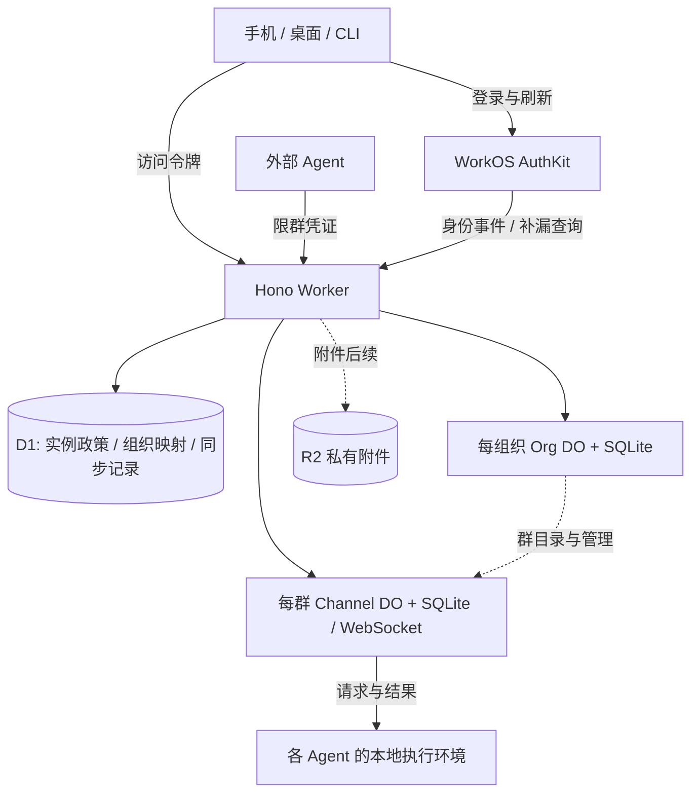

# TOB — WorkOS architecture and first heterogeneous-agent path

Canonical delivery specification: https://github.com/BotHarness/tob/issues/1

状态：Human 已确认 WorkOS 路线、测试边界、T1–T5 拆分及 Open Cloud Groups 专项 Project；批准发布，暂不启动实现。已授权创建公开 TOB 仓库与迁移规划；不授权正式实现、配置外部账号、部署或收费。日期：2026-10-17。

## Problem Statement

一个 Human 的 Agent 分布在不同电脑和运行时中，缺少同一个手机群聊入口来协作。依赖某台 Host 在线或外部聊天镜像，会限制独立 Agent 接入与自部署。用户需要开放的群服务，手机可直接管理并参与群聊，工作仍在各 Agent 的环境内按主人授权执行。

## Solution

独立开源服务提供组织业务、群权限、公开消息协议及 CLI。WorkOS 管登录、账号和组织身份，Cloudflare 管群协作。DeepSeekBot 桌面与现有 Expo App 提供界面，外部 Agent 无需 DSH/BotHarness。

首个交付目标：手机登录自己的实例并创建群 → 接入 Mac 上的 DeepSeekBot A 与另一电脑的独立 Agent B → 手机 @A → A 向 B 转交预授权本机检查 → B 回报同群 → 手机看到结果。随后验证断线补历史、撤权和不重复工作；结果不明时明确报告。

T1 的入口限定为部署者独立核验过的实例，且只有已初始化的 active 实例管理员能进入业务和建组织；后续切片不自动放开此限制。

首条路径只是完整 MVP 的第一部分。本规格不把企业 SSO、auth.md、自建网盘或收费作为其前提。

## User Stories

1. As an 实例部署者, I want 在自己的 Cloudflare 账号部署独立服务, so that 不依赖官方托管账号。
2. As an 实例部署者, I want 受保护的管理员初始化与恢复入口, so that 公网访问者不能抢占实例。
3. As an 已初始化实例管理员, I want 输入或扫码选择部署者独立核验并固定配置的 HTTPS 实例, so that 在 T1 连接已确认归属的服务。
4. As a Human, I want 通过该实例配置的 WorkOS 登录手机, so that 不需要先配对一台本地 Host。
5. As a Human, I want 凭证和缓存按实例及身份隔离, so that 切换服务不会混用账号或消息。
6. As a Human, I want 在被允许时创建自己的 Organization, so that 群和成员有清晰归属。
7. As an 获授权组织成员, I want 用手机创建 Channel, so that 初次配置不依赖桌面端。
8. As a Human, I want 发送文本、选择 @目标并读取持久历史, so that 在线与断线后的讨论保持连续。
9. As a Human, I want 看到待发送、已提交和工作结果的区别, so that 不把收到消息当成执行成功。
10. As a 群管理员, I want 在手机创建并撤销限群的 Agent 凭证, so that 外部运行时能独立接入。
11. As an Agent 作者, I want 通过 HTTP 和主动连接的 WebSocket 使用群协议, so that 不需要公网接收端或 DSH 依赖。
12. As an Agent 作者, I want 可运行的参考程序, so that 能复现认证、收发、补历史和结果回报。
13. As a Human, I want 分辨重名 Agent 的身份及执行环境, so that 不会请求错误的电脑。
14. As a Bot 主人, I want 显式把本地 Bot 接到指定云群, so that 本地私聊、Memory 和文件不会自动上传。
15. As a Human, I want 手机 @DeepSeekBot 后由它转交给另一 Agent, so that 可以在一个群内完成跨设备协作。
16. As a Bot 主人, I want 转交保留原始请求人和权限上限, so that 代理关系不会扩大工作权限。
17. As a Bot 主人, I want 固定本机检查只有预授权请求才能触发, so that 入群不等于任意 shell 或文件访问。
18. As a Human, I want Agent 离线时仍可使用云群, so that 手机聊天不依赖电脑在线。
19. As a Human, I want 重试和重连不会重复启动同一请求, so that 网络故障不会重复工作。
20. As a Human, I want 过期、撤权和结果不明有明确状态, so that 可以判断是否需要重新授权或人工核对。
21. As a 群管理员, I want 撤销凭证阻止已有连接继续读写, so that 撤销实际生效。
22. As an 组织成员, I want 其他组织和非成员无法访问本群, so that 服务端保护组织及群边界。
23. As a CLI 用户, I want 所有本切片管理能力都有相同权限的命令, so that 无需 UI 或模型也能操作和验证。
24. As a Human, I want 知道服务端可处理正文且 Agent 可能调用外部模型, so that 理解内容的实际处理边界。
25. As an 维护者, I want 验证 WorkOS 登录、刷新与现有连接撤权, so that 托管身份与本地群权限保持一致。

## Implementation Decisions

### 1. 仓库、平台与身份

- 开源服务独立仓库：Hono API/RPC、HTTP/OpenAPI 与 WebSocket 合同、Worker/DO 业务、Drizzle、CLI、参考 Agent 和部署说明。Forge 采用同一命令合同派生多入口的架构；不复制 UI/CLI 业务权限。具体生成器接入随首条命令验证。
- DeepSeekBot 仓库：现有 Host Messaging 适配、桌面绑定入口、现有 Expo App。服务本身不提供聊天 Web UI。WorkOS 托管登录页面与必要回调不属于独立聊天 UI。
- 私有官方运营仓库后续只处理托管运营与收费，复用开源权限和消息服务。公开仓库已确认为 BotHarness/tob（TOB — Thousands of Bots），许可证待定；规格与任务迁入 TOB tracker，组织级 Open Cloud Groups Project 同时关联 TOB 与 DeepSeekBot。
- Instance → Organization → Channel。Organization 就是云端工作区，不等于 DSH 本地 Workspace。用户可以属于多个组织；应用层 org_id 映射到该实例 WorkOS organization_id。
- WorkOS 是用户、会话、组织成员、组织角色及身份邀请的权威。应用不另建密码/会话数据库，不继续实现 Better Auth 或 Auth DO。之前 Better Auth 的 DO/D1 探针是历史调研，不再阻塞当前路线。
- 自部署使用部署者自己的 Cloudflare 账号和 WorkOS 环境/密钥。不需要 DSB 官方账号；但需要连接 WorkOS 云服务。这明确替代早期“自部署免外部身份服务”的假设。

### 2. 第一条路径的身份与部署合同

- T1 只接入部署者独立核验过的实例。部署者从自己控制的 Cloudflare 与 WorkOS 配置核对并预先固定 API HTTPS origin、WorkOS Client ID、issuer/认证端点与移动回调的组合；不能仅凭目标实例返回的 discovery 或二维码完成核验。手机和 CLI 只使用该已核验组合，未知地址或配置不匹配时在发起登录前拒绝，不向它发送 token；配置变化须重新核验。公开发现仅检查兼容性与一致性，不建立信任。任意陌生实例即插即用不属于 T1。
- 手机保持系统浏览器 Authorization Code + PKCE，CLI 保持设备授权；不增加认证中转、第二种 Human 会话、DPoP 或自动实例登记机制。手机 OAuth 专用回调定为 `ai.botharness.deepseekbot:/oauth2redirect`，开发版为 `ai.botharness.deepseekbot.dev:/oauth2redirect`，分别精确登记；现有 deepseekbot 导航 scheme 不作为新的 OAuth 回调。state、verifier、已核验实例及回调绑定为一次性事务，仍须真实原生构建验证。
- 首条路径只启用一种 WorkOS 托管登录方式，建议邮箱密码；CLI 采用受支持的设备授权/浏览器确认流程。不自行接收用户密码来绕过登录。邮箱 OTP、Google、完整登录配置管理保留后续切片；用户名别名不是首片前提。
- WorkOS 默认邮件替代原 Cloudflare 发 OTP 的默认假设；若后续仍要求 Cloudflare 发信，单独验证自定义邮件集成。当前不配置或发送邮件。
- 实例管理员通过部署者受保护的初始化动作绑定到明确的 WorkOS user id，不能由首位公网注册者抢占。部署者可恢复管理资格；账号恢复交给 WorkOS，不重新实现密码重置。
- 注册、实例准入、创建组织、组织内建群是不同判断。T1 固定 registration_mode=admin_only、org_creation_mode=admin_only，WorkOS 关闭公开注册。仅本实例 instance_admin 中 status=active 的已初始化 Human 可进入业务入口或建组织；有效 WorkOS token、邀请记录或普通组织成员资格均不能替代此条件。缺少初始化/政策记录或无法确认管理员状态时拒绝业务管理；匿名发现/健康信息不授予业务访问。邀请其他 Human 的后续切片再扩展准入规则，不新增用户/邀请账本或通用策略编辑器。
- WorkOS 新环境默认 member 不代表内置 owner。自部署必须建立/核验固定单角色 owner/member，member 保持默认，不自动升权；doctor 检查角色、单角色模式及映射是否匹配，不匹配时阻止建组织。组织创建者显式获得 owner，未知角色默认拒绝有权限要求的操作。实例管理员资格只授予 T1 准入、建组织及实例管理权限，不自动赋予其他组织的业务访问或任意 Agent 工作权。组织访问仍要求该组织的 active membership，组织管理还要求 owner；member 无组织管理权。
- Worker 使用服务器密钥调用 WorkOS 管理 API 前，仍检查当前 Human 的应用权限。群 token 不能换取此能力。所有已交付管理能力都有独立服务 CLI；本地 Bot 操作有 DeepSeekBot CLI。
- 未来企业 SSO/目录同步可利用 WorkOS，但本批任务不启用付费连接，不承诺所有 OAuth 配置都有管理 API。正式管理切片需核对 CLI 可覆盖范围。

### 3. 持久数据与库表

以下是第一条路径的逻辑 schema 合同。主键、唯一性、owner 与状态语义先确定；正式迁移由相应切片提交。ID 为不含秘密的稳定字符串，时间为 UTC，状态字段由运行时 schema 校验。跨存储引用不是 SQL 外键。

| Owner / 表 | 主要字段与约束 | 用途 |
| --- | --- | --- |
| WorkOS 受管实体 | User、Session、Organization、Membership、Invitation | 云端身份权威；不在应用复制成可独立修改的认证表 |
| D1 / instance_config | singleton_id PK、registration_mode、org_creation_mode、config_version | T1 两项模式固定 admin_only；缺失/非法值拒绝业务管理；不保存 API key 明文 |
| D1 / instance_admin | workos_user_id PK、granted_by、granted_at、status | 实例超级管理员，区别于组织 owner |
| D1 / organization_link | org_id PK、workos_org_id UQ、lifecycle、created_at | 实例内稳定组织映射；creating/active/disabled |
| D1 / management_operation | operation_id PK、actor_id、kind、payload_hash、target_id、state、updated_at | 创建组织/映射的重试状态；同键不同载荷冲突 |
| D1 / identity_event_inbox | event_id PK、event_type、resource_id、org_id 可空、status、received_at、attempt_count | 事件去重、可靠投递与错误恢复；只保留所需脱敏字段 |
| D1 / identity_sync_checkpoint | stream_id PK、cursor、last_success_at | 补漏进度；已持久接收后才推进，不因投递失败丢事件 |
| Org DO / org_config | org_id PK 单行、status、policy_json、version | 组织业务设置；不复制成员权威 |
| Org DO / channel_directory | channel_id PK、display_name、lifecycle、source_version、created_by、created_at | 本组织群目录；群名为展示投影 |
| Org DO / management_operation | operation_id PK、actor_id、kind、payload_hash、target_id、state | 幂等建群、撤权传播及失败重试 |
| Org DO / member_access_projection | workos_user_id PK、membership_id、status、role、verified_at | 可重建权限投影；只能按权威身份数据更新 |
| Org DO / identity_delivery | event_id + target_channel_id 复合 PK、status、attempt_count | 记录哪些群已接受身份变更，防止只发一次内存通知 |
| Channel DO / channel | channel_id PK 单行、org_id 不可变、name、status、last_seq、acl_version | 本群配置、消息顺序和权限版本 |
| Channel DO / channel_member | actor_id PK、kind、workos_user_id 可空、owner_user_id 可空、display_name、environment_label、role、status、read_from_seq | Human 与 Agent 的群内身份；CHECK 保证身份字段匹配 kind |
| Channel DO / agent_credential | credential_id PK、actor_id FK、secret_hash、scopes、expires_at、revoked_at | 限群凭证；允许轮换，仅保存秘密校验值 |
| Channel DO / message | seq PK、message_id UQ、author_actor_id FK、client_message_id、kind、body_json、parent_message_id、request_id、payload_hash、created_at | UQ(author_actor_id, client_message_id)；按 seq 分页 |
| Channel DO / management_operation | operation_id PK、actor_id、kind、payload_hash、state、result_ref | 凭证签发/撤销等管理操作去重；不存明文秘密 |
| Channel DO / access_revocation | scope_type + scope_id 复合 PK、event_id、applied_at、expires_at 可空 | 已知 session/成员撤权跨休眠和重启保留；只影响相应 scope |

约束与解释：

- D1 只存应用登记和可靠同步，不为每条消息或每个接收者写一条身份查询记录。Secrets 留在部署配置；跨实例令牌/密钥不混用。
- WorkOS organization id 与应用 org_id 一一映射；客户端 active organization 只是导航状态。服务端验证访问令牌、目标 org 和 Channel 的归属，不能由 URL 参数赋予资格。
- 群私有：组织成员资格不意味着能看所有群名称或消息。目录列表按实际群访问范围过滤；首片可做有界分页核验，不先建设全局搜索索引。
- actor_id 与显示名分离；不同主机上的同名 Bot 是不同身份。首版外部 Agent 是群限定身份，不建立全局 Agent 应用商店。
- message 的 kind 区分文本、工作请求、结果和系统事件。系统事件记录成员/凭证变更但不泄密；消息作者派生自受信上下文。
- read_from_seq 默认加入后的下一条序号。同一 Human 换设备继承本人历史；新 Agent/新 Human 默认不读旧历史。重新加入不自动恢复旧权限。显式授予旧历史后续实现。
- 退出成员标记状态，不级联删除历史作者。删除、保留时长与导出完整政策留正式试用前收敛；首片测试数据不以清库掩盖迁移问题。
- WebSocket 对象不存入 SQL；连接恢复读取持久群权限和撤权状态。推送/未读全局聚合不属于这批表。
- R2 附件与 attachment 元数据表留后续切片；Paid 单群 SQLite 10 GB 的归档扩展暂不设计。R2 不是 SQLite 自动溢出盘。
- 参考 Agent 本地保存唯一请求键、授权、started/finished/needs-review 状态和结果；DeepSeekBot 复用既有 Messaging/Runtime，不建云端第二套执行权威。

### 4. 跨存储状态、授权和失效

- 创建 Organization 涉及 WorkOS 与应用映射，创建 Channel 涉及 Org DO 与 Channel DO。均无跨系统事务。稳定 operation_id 持久记录 creating → active；初始化失败或响应丢失重试同一逻辑资源，不重复创建。WorkOS API 的幂等能力须在 T1 验证，不凭空假设。
- 群目录是投影，群配置由 Channel DO 拥有。名称更新携带源版本，过期投影可重建，不能覆盖较新群状态。
- Worker 验证 WorkOS JWT 的签名、签发者、有效期及实际令牌用途/客户端约束；组织声明还要匹配目标。缓存可信公钥，不把每条群消息都远程发给 WorkOS 查询。
- Token 不是永久权限快照。已有连接需处理到期、刷新、组织移除和会话撤销；身份事件经签名校验、持久去重及可靠投递到目标群，Events API/对账承担补漏。
- 不以事件送达顺序推断当前权限。针对不具备可靠版本的资源变更，查询权威状态再更新投影；迟到的旧事件不能恢复已撤销资格。
- 外部身份变更存在传播延迟。T1 明确并测量失效窗口/故障策略；应用发起的撤权在目标连接确认前显示处理中，超时明确报告。不能承诺 JWT 本地验证等于即时全球撤销。
- Agent 凭证由 Channel 本地验证；撤销立即拒绝后续本群读写并处理已有连接。其主人组织资格被撤销时，按当前工作授权一并停止尚未开始的工作资格；不能因 token 本身未过期而继续。
- 请求来源与 Agent 的工作权限分别校验。Human H → A → B 保留原始 H，A 不可通过转发把自己的更大权限借给 H。云端认证不替代 Workspace Grant、工具审批或第三方执行端的策略。

### 5. 消息与本地执行

- 公开 HTTP 支持管理、发送、历史游标；WebSocket 支持实时事件和断线重连。DO 内完成去重、分配 seq 和写消息后才确认；同发送键不同内容拒绝，ACK 只表示消息提交。
- @目标与回复关系是结构化字段，普通文本不能伪造请求来源。保留 root/parent/request_id 与有界转交次数；只有目标 Agent 处理有效工作请求，结果消息不自动触发往返循环。
- 首个工作固定为 health-check：返回预定的运行环境标识和受限诊断字段，不接受任意 shell/路径；用独立执行计数证明确有执行且未重复。
- 主人预授权指定请求人、目标和固定能力。执行前检查当前资格、有效期和本地去重记录；开始后结果不明进入 needs-review，不盲目重试。重新发起工作是新授权请求，不是传输重试。
- 本地结果与待发送意图持久化，重发结果不重做工作。历史补齐默认不是新工作；已过期/撤权/前提改变请求报告拒绝或待确认。
- 手机区分待发送、已提交、工作已开始、完成、拒绝和待核对。电脑离线仅表示连接状态；在线电脑和手机仍可经云端聊天。

### 6. DeepSeekBot 与移动端边界

- 云群是 application-defined。DSH Plugin/Fiber 管连接生命周期；沿用 Service Definition、现有 API Gateway/Typert seam，不创建第二个网关 interceptor。
- 云入口通过既有 Messaging owner 提交受信身份、Source Event、placement、Admission 和检查点。远端 Human 不是本地 Human；外部 Agent 不伪造成本地 PersonaBot；只给本机拥有的 Bot 创建执行 Admission。
- 发送意图耐久保存，进程内 output 通知仅唤醒 sender。复用 Runtime 已有中断/needs-repair 语义，不通过重放重置执行记录。
- 桌面支持显式绑定云群与本地 Bot，并有相同 CLI；手机无需配对 Host，可独立登录、创建群和管理 Agent。切换或关闭本地 Host 不影响云会话。
- 服务端可处理正文；不做 E2EE/MLS。仅主动共享的云群同步；不自动上传本地私聊、Memory、Session 或文件。成员知道 Agent 可能使用外部模型。
- 手机令牌安全保存，缓存与 outbox 按实例/用户隔离；退出和换实例不会把待发送内容发到另一个服务。首片以前台收发和恢复为正确性路径，不承诺后台常驻连接。

### 7. 容量与部署资源

- 一套 Worker + D1 + Org/Channel DO namespace；附件阶段增加 R2。自部署配置自己的 WorkOS Client ID/API key、回调、事件校验和实例地址，不共享官方凭证。
- WorkOS 负责身份服务运行，不代表聊天无限容量。Channel DO 热点仍需测量；采用休眠 WebSocket、有界队列、分页补历史，避免每 token 一条持久消息。
- 首条路径至少记录完整消息端到端时延、重试/拒绝/错误率和执行计数。100/1,000 连接负载曲线属于后续容量工作；首片不能据连接上限宣称 100+ Agent 已验证。
- 本轮不配置 WorkOS、不部署或发送消息。后续实施先取得任务启动授权，并按已有共享设备 QA 流程验证手机。部署、付费企业连接及测试账号操作仍需对应授权。

## Testing Decisions

建议以一个最高层入口为主：**手机/CLI/参考 Agent → 同一公开 HTTP/WebSocket 合同 → 真实持久 owner → 可见结果**。Human 已确认此测试边界。

- 服务合同测试使用真实 Worker/D1/SQLite DO，验证跨组织/群拒绝、消息去重、历史边界、游标及撤权。测试 WorkOS 令牌及事件可使用受控签名 fixture，但必须另有获授权 staging 的真实登录/刷新/撤销证据；fixture 不冒充集成通过。
- Host 复用既有 Messaging 入站、身份、Outbox/撤权测试与 CLI 同命令先例，不为云适配重写第二套 Messaging。新增用例只覆盖云 actor、来源传递、持久发送和恢复行为。
- 手机沿用现有群管理网络调用及错误状态测试，另做真实手机无 Host 登录、建群、凭证管理、完整协作和回前台恢复。Node/Web 测试不代替原生回调与安全存储验证。
- T1 必测：未核验地址、冒用其他实例 Client ID、核验后配置漂移均在登录/token 发送前被拒绝；未初始化、非 active 管理员及仅有有效 WorkOS token 的用户不能进入业务或建组织；owner 缺失/映射不符不能建组织；跨组织访问仍需 active membership。正式与开发 OAuth 回调精确匹配，旧导航回调不得完成云登录。
- 每票有自动回归、可运行 CLI 路径、可操作界面与 Human QA。先验证前一条用户行为再扩展下一条，不先交付整层数据库或只交付无后端 UI。
- 故障注入：云提交后 ACK 丢失、Host 本地提交后通知前崩溃、Agent 开始后结果持久化前崩溃、结果已保存但发送失败、重连/历史重放、过期与撤权。以持久消息、执行计数、公开状态和实际手机结果判断。

## Out of Scope

T1 不支持任意未核验实例的自动信任，不引入新认证/实例登记协议、通用权限编辑器或额外用户/邀请账本。部署者手工核验是本切片明确的信任前提，不宣称已解决任意自部署实例的自动可信接入。

本批不拆票：邀请另一位仅手机 Human、显式历史授权、完整 OTP/Google/登录管理覆盖、企业 SSO/目录同步、auth.md 自助认领、入站 Webhook、官方收费/额度运营、附件、真实推送以及全面自部署升级/备份。此前确认的相关 MVP 能力仍保留；此次仅推迟到首条路径之后。

不实现 Better Auth 备用路线、Auth DO、独立聊天 Web UI、联邦、VPS/Docker、自建网盘/CRDT、跨机自动接管、全 Host 远控、任意 shell 工作或完整权限设计器。开源服务的独立部署仍依赖部署者配置自己的 WorkOS 云身份服务。

## Further Notes

任务按五条可操作切片排序：T1 手机/CLI 登录并建立组织 → T2 手机建群与持久文本 → T3 手机接入外部 Agent 并得到固定检查结果 → T4 手机 @DeepSeekBot 转交外部 Agent → T5 同一路径故障恢复与整体验收。

每条仅由其前一条阻塞；T4 证明正常路径，T5 后才可宣称首条完整验证路径交付。WorkOS 集成验证纳入 T1，不保留旧 Better Auth 修复门槛或横向认证基础票。

Human 已明确暂不实现。全部挂起为 ready-for-human，明确启动后再转换为可领取任务；此次额外授权创建公开 TOB 仓库及迁移规划；不授权实施、部署、收费或账号配置。统一归入 Open Cloud Groups Project，使用原生 sub-issue/dependency 关系；不绑定未决定的发布里程碑。

官方机制依据：[WorkOS 会话](https://workos.com/docs/authkit/sessions)、[用户与组织](https://workos.com/docs/authkit/users-organizations)、[CLI Auth](https://workos.com/docs/authkit/cli-auth)、[身份事件](https://workos.com/docs/events)、[自部署接入](https://workos.com/docs/on-prem-deployment)、[DO WebSocket](https://developers.cloudflare.com/durable-objects/best-practices/websockets/)。这些资料支持机制选择，不代表本项目已经完成运行时集成。

规划文档：[仓库 README](https://github.com/BotHarness/tob#readme)、[T1 展开方案](https://github.com/BotHarness/tob/blob/main/docs/t1-design.md)。TOB 仅完成公开规划仓库初始化，未开始服务实现。

本次审查修订依据：[WorkOS roles](https://workos.com/docs/authkit/roles-and-permissions)、[WorkOS invite-only](https://workos.com/docs/authkit/invite-only-signup)、[RFC 8252 §7.1](https://www.rfc-editor.org/rfc/rfc8252.html#section-7.1)、[RFC 9700 §4.9.1](https://www.rfc-editor.org/rfc/rfc9700.html#section-4.9.1)。仅更新设计与验收，不启动实施。
