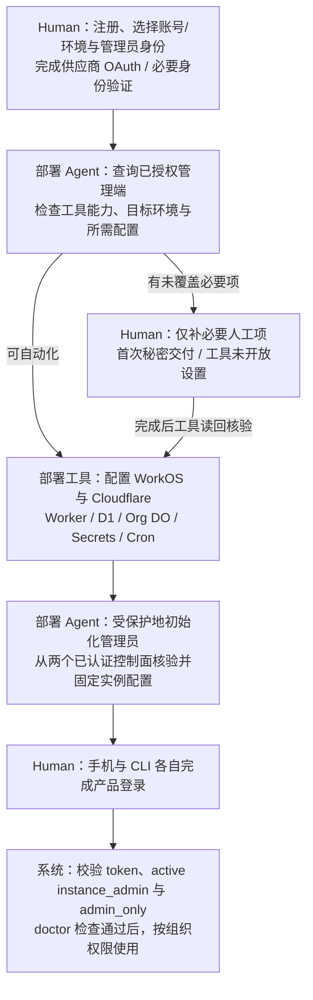
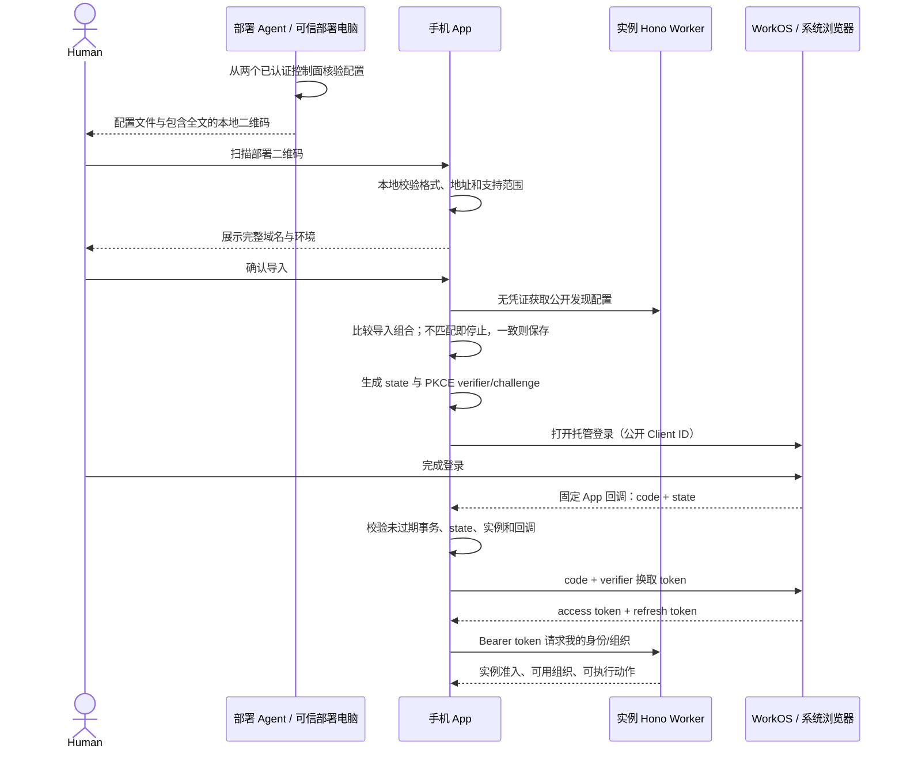

# T1 展开：仓库、自部署、手机与 CLI 登录

日期：2026-10-17。状态：Human 已认可的细化方案；TOB 公开规划仓库与任务迁移已获授权，未实现、未部署 TOB 服务；已另获授权准备 WorkOS TOB staging 并完成 MCP 核验。

关联：[Spec #1](https://github.com/BotHarness/tob/issues/1)、[T1 #2](https://github.com/BotHarness/tob/issues/2)。本次仅收敛 T1，不扩大 T2–T5。

## 1. 要确认的结果

部署者使用自己的 Cloudflare 和 WorkOS，完成注册、身份验证与授权；部署 Agent 优先通过 CLI/MCP 配置、部署，并从已认证控制面独立核验实例配置。T1 只允许已初始化且 active 的实例管理员进入业务和创建组织。手机没有任何已配对 Host，从已核验实例配置登录、创建自己的组织；CLI 登录同一身份，看到同一组织。两边退出、刷新、组织切换和失权均可验证。

推荐手机采用 AuthKit Authorization Code + PKCE，CLI 采用 AuthKit Device Authorization。登录直接连接 WorkOS，业务访问 Hono Worker。无需 Auth DO、应用密码表或自行签发第二种 Human 会话。

手机 PKCE 有 [WorkOS 官方 Expo 示例](https://github.com/workos/expo-authkit-example)；[Device Authorization](https://workos.com/docs/authkit/cli-auth)也可用于手机，但多一次验证码确认/返回 App 操作，保留为候选而非首片同时交付两种登录方式。两者均不需要客户端携带服务端 API key。

## 2. 新仓库组织

项目名 TOB — Thousands of Bots，仓库 `BotHarness/tob`。CLI 拟名 `tob`；npm scope 和许可证尚未正式确定。以下是目标目录；目前仅 docs、README 与人工准备脚本 scripts/prepare-first-deploy.sh 已交付，其余目录不代表已存在或开始创建。

```text
tob/
  apps/
    service/             Hono Worker、身份适配、应用命令、Org DO
      src/
      db/d1/             Drizzle schema 与 D1 SQL migrations
      db/org/            Drizzle schema 与 Org DO migrations
      cloudflare.config.ts  cf 配置：bindings、兼容日期、环境、定时任务
    cli/                 面向用户/管理员的薄 HTTP 客户端
  packages/
    contracts/           请求、响应、错误码、公开发现文档与协议版本
    client/              平台无关客户端；会话/安全存储通过平台适配
  scripts/prepare-first-deploy.sh  已交付：仅本机人工准备
  tools/deployment/      规划：部署、诊断、受保护的超级管理员初始化/恢复
  tests/                 公开合同和真实 Worker/D1/DO 集成测试
  docs/                  部署说明、协议、架构、ADR、验收操作
```

- T2 增加 Channel DO 与群消息合同；T3 增加独立参考 Agent。T1 不提前建立未使用的 Agent SDK、计费包或文件服务。
- 现有 DeepSeekBot 仓库继续拥有 Expo App、桌面入口、Host 适配和本地 Bot CLI。不搬迁产品，也不在新仓库提供聊天 Web UI。
- Forge 在这里是“一套服务端命令/校验合同，多入口消费”的组织原则。以现有 links 服务的单一 OpenAPI 合同先例为参考，不假定引入一个名为 Forge 的运行时依赖。
- Hono 路由执行应用命令与权限检查；CLI、手机调用同一 API。Hono RPC 服务 TypeScript 调用，OpenAPI/JSON 为其他语言提供公开合同；避免让外部 Agent 导入服务器包或依赖 Hono 才能访问。
- Drizzle 的 D1 与 DO schema/迁移分别归各自 owner；不把它们当成一个可以跨库 join/transaction 的数据库。官方分别提供 [D1](https://orm.drizzle.team/docs/sqlite/connect-cloudflare-d1)和 [DO SQLite](https://orm.drizzle.team/docs/sqlite/connect-cloudflare-do)驱动。锁定实际验证版本，不把当前文档推荐的 RC 自动当作项目升级决定。

## 3. 自部署资源清单

| 平台 | T1 需要 | 作用 |
| --- | --- | --- |
| Cloudflare | 一个 Worker | Hono API、公开实例信息、身份事件接收、定时补漏、组织管理 |
| Cloudflare | 一个 D1 database | 实例政策、超级管理员、组织映射、管理操作、事件收件记录和补漏进度 |
| Cloudflare | 一个 Org DO namespace，SQLite backend | 按 org_id 创建组织业务状态与只读身份投影；不是每组织手动配置一个 binding |
| Cloudflare | HTTPS 地址 | 可先用 workers.dev；自定义域名可选，API 与登录发现需保持稳定 origin |
| Cloudflare | Worker Secrets | WorkOS API key、事件签名校验 secret；不放源码或 App |
| Cloudflare | Cron Trigger + Worker 日志 | 有界补漏/重试、同步健康；事件处理与 checkpoint 持久化，日志去除令牌/认证码 |
| WorkOS | 部署者自己的项目/环境，T1 一个 AuthKit application | 该实例用户、会话、组织、成员；开发与生产环境隔离 |
| WorkOS | 公共 Client ID、托管登录域名、服务端 API key | App/CLI 只拿公开配置；API key 留在 Worker |
| WorkOS | 登录方式、移动回调白名单、Sign-out URI | 首片一种托管登录方式，沿用 spec 的邮箱密码建议；完整 OTP/Google 后续 |
| WorkOS | 身份事件端点及签名 secret | 发往本实例 Worker；Events API 补漏，同步资格变化 |
| WorkOS | 固定单角色 owner/member | 明确创建 owner，member 保持默认；核验角色和动作映射，缺失或不符阻止建组织 |

T1 不需要 R2、KV、Queues、Cloudflare Tunnel、Cloudflare Access 或邮件发送服务。T2 才增加 Channel DO namespace；R2 在附件切片增加。Cron 与 D1 inbox 足够首片的低频身份事件恢复，暂不增加另一种队列资源。

Cloudflare 资源通过 [bindings](https://developers.cloudflare.com/workers/runtime-apis/bindings/)连接；秘密使用 [Worker Secrets](https://developers.cloudflare.com/workers/configuration/secrets/)，补漏可使用 [Cron Triggers](https://developers.cloudflare.com/workers/configuration/cron-triggers/)。本方案优先采用 cf CLI 与 cloudflare.config.ts，锁定实际验证版本；cf 仍为 beta。若某项操作必须使用 Wrangler，应记录原因与实际配置路径，不让两套项目配置各自成为权威，也不在未经迁移的 Wrangler 项目直接运行 cf 构建/部署。一键部署按钮不是 T1 前提。

WorkOS 自部署模式意味着“业务运行在自己的 Cloudflare，身份仍在 WorkOS 云端”，不等于离线自托管 WorkOS。每个部署使用独立环境/凭证，不能共用 DSB 官方身份库。[WorkOS 自部署说明](https://workos.com/docs/on-prem-deployment)

### 配置归属

下列是建议配置合同，名字在实现时统一：

| 类别 | 内容 | 放在哪里 |
| --- | --- | --- |
| 公共实例配置 | INSTANCE_ID、PUBLIC_BASE_URL、协议版本 | Worker vars / 公开发现文档 |
| 公共认证配置 | WORKOS_CLIENT_ID、受支持 issuer/AuthKit domain、固定移动回调 | Worker vars / 公开发现文档 |
| 服务端秘密 | WORKOS_API_KEY、WORKOS_WEBHOOK_SECRET | Worker Secrets |
| 应用政策 | registration_mode=admin_only、org_creation_mode=admin_only、配置版本 | T1 固定两项模式；D1 缺失/非法值拒绝业务管理，不提供策略编辑器 |
| 资源绑定 | D1 的 INSTANCE_DB、Org DO 的 ORGS | cf 项目配置，不需要把数据库密钥交给手机 |
| 部署权限 | Cloudflare deploy 凭证 | 部署者机器/CI，不进入业务 App 或普通 CLI 登录配置 |
| 用户凭证 | Access/refresh token | 手机安全存储、CLI OS 凭证库或明确配置的受限文件存储 |

WorkOS OAuth 设置不假定能靠我们的环境变量自动创建：Google 后续仍需在 WorkOS/provider 完成真实接入配置。T1 保持一个 application 服务手机与 CLI；日后要独立会话策略可拆 application，但保留同一环境的用户/组织。[WorkOS Applications](https://workos.com/docs/authkit/applications)

## 4. Agent 优先的自部署与初始化

“部署者负责”表示由部署者选择账号、授权范围并承担实例归属，不表示必须由人逐项操作控制台。Human 完成必要注册/身份验证与 OAuth 后，Agent 通过官方 CLI/API 或已授权 MCP 代办范围内的动作，无需逐项重复确认；这不是授予后续群主 Bot 云账号权限。

### 已交付的首次部署人工准备向导

入口：`bash scripts/prepare-first-deploy.sh tob-staging`；[脚本](../scripts/prepare-first-deploy.sh)、[使用说明](first-deploy-preparation.md)。这是一份可运行的本机准备工具，不是安装器，也不标志 T1 部署或登录路径完成。

1. 展示 Cloudflare / WorkOS 注册、登录及 API key 说明 URL；仅打印文本，不打开浏览器，不收集账号密码或 OAuth token。
2. Human 从 Cloudflare 控制台复制 Account ID（提供 Cmd/Ctrl+K → Copy account ID、Workers & Pages 路径与 URL 示例），填写 WorkOS Team / Project 名称，固定 Staging；写入本机 deployment.env。Cloudflare ID 校验为 32 位十六进制并统一为小写，但格式不证明账号归属、权限或排除 Zone ID，仍由后续 Agent 从已授权控制面核验。旧版账号名称保留，明确确认同一账号后补 ID；已保存 ID 不允许换绑，不修改已有秘密。
3. Human 在目标环境取得服务器 API key，通过终端隐藏输入保存到仓库外 secrets.env；只包含 WORKOS_API_KEY，不含 Webhook secret。两份文件位于 ~/.config/tob/first-deploy/<profile>/，目录 0700、文件 0600，不进入公共连接配置或二维码。
4. 输出同机部署 Agent 的交接路径与待办；状态为 inputs_saved_unverified。向导不进行网络请求、工具 OAuth、发邀请、创建 Webhook、注入 Worker Secrets、迁移或部署；不会调用尚未实现的自动部署命令。

中断后同 profile 重跑复用已有值，不替换/轮换 key；已保存目标字段不可改绑，换目标用新 profile。秘密存在而目标记录不完整则停止。脚本拒绝符号链接、Git 仓库内秘密存储及非交互输入，避免两个同 profile 进程同时写入；意外强制终止遗留锁需先确认旧进程已退出再处理。

本次发布证据限于 Bash 语法、--help、非交互拒绝及静态检查（模板库不变、四步、不调用开网页/云写入）。未运行完整交互或真实 key 流程；shellcheck 当前未安装。后续需分别验证隐藏输入/文件权限/中断重跑、工具授权与实际目标、API key 可用性、Webhook 签名秘密交接、Worker 注入及真实部署。向导结束不关闭“秘密与 Cloudflare 交接”缺口，不释放 T2。

### 人与 Agent 的分工

| 步骤 | Human 必要参与 | Agent / 工具执行 |
| --- | --- | --- |
| 账号与环境 | 注册自己的 Cloudflare/WorkOS 账号；选择目标账号/环境、实例地址、初始化管理员身份与授权范围 | 查询当前已认证账号、环境和可用权限，防止落入其他账号或生产环境 |
| 工具授权 | 完成 cf 与 WorkOS CLI/MCP 的供应商登录、OAuth、必要 MFA；如团队禁用 MCP/写入则由有权的人开放或选 CLI | 发现受支持命令/操作；CLI 与 MCP 会话分别核验，不以安装配置代替登录成功 |
| WorkOS 配置 | 只处理官方工具未开放的必要设置；首个管理员按实际流程接受邀请、登录/验证身份 | 配置可支持的登录设置、精确回调、退出地址、owner/member、事件端点；公开注册关闭、single-role/member 默认值须读回核验 |
| 运行秘密 | 若无法自动获取初始环境 API key/事件签名秘密，放入本机私密文件或凭证存储，不粘贴进聊天 | 部署工具读取受保护输入并注入 Worker Secrets；普通输出、日志及模型上下文不包含秘密 |
| Cloudflare 资源 | 不要求手工创建每个资源；仅补充工具确实无法完成的授权/必要步骤 | 用 cf 创建/连接 Worker、D1、Org DO binding，执行迁移，配置 Secrets、HTTPS、Cron；记录绑定与实际版本 |
| 初始化管理员 | 选定本人目标邮箱；亲自接受邀请并完成托管认证/邮箱验证 | 按邀请实际接受者核验 user_id；以获授权 Cloudflare 管理权限原子写入 D1 管理员与首次回执，中断先读回，恢复另行授权 |
| 实例独立核验 | 不要求逐字段抄录；权限或归属无法确认时才处理例外 | 从已认证 Cloudflare/WorkOS 管理端交叉核验 origin、Client ID、issuer/认证端点、精确回调，形成固定连接配置 |
| 诊断与使用 | 手机/CLI 分别完成自己的产品登录，进行 Human QA | 通过管理员业务会话运行 doctor，报告配置/角色/同步状态；两端按同一业务权限建组织 |

工具能力边界必须显式记录：

- WorkOS MCP 继承授权者的 Dashboard 权限，可能被团队禁止写入或访问生产；它不能修改限制自身的 MCP 设置。
- MCP 不返回秘密，也不创建/轮换 API keys、OAuth client secrets 等凭证。CLI 中组织 API key 管理不能证明可无初始凭证取得环境服务端 API key。首次运行秘密交付保留必要人工路径。
- 已通过真实 MCP 读取注册、角色与回调配置，发现 updateAuthkitSettings、createRole、updateRoleConfig 和回调/退出设置接口。注册当前开启，默认 member/单角色已符合，owner 缺失。关闭注册/角色配置不再默认列为人工；持久化写入与读回仍待实施验证。详见下方证据表。
- Human 在供应商页面接受首次邀请/验证身份、注册、OAuth/MFA 是必要交互；角色创建、回调登记、资源创建与部署不是默认人工项。不承诺目前所有环境都只需注册和 OAuth。
- 控制面授权、TOB 服务端运行秘密、手机/CLI 产品会话是三类不同凭证。初始化恢复只能恢复实例管理员资格，不能绕过 WorkOS 账号认证。

### 执行顺序

1. Human 完成账号准备、目标选择和工具授权；Agent 查询并确认账号/环境、权限与工具版本。
2. Agent 按项目/environment_id/application 锁定目标并发现实时工具合同；以最小差异关闭 signup、建立 owner、保持 member 默认和单角色、准备精确回调与选定退出地址，写后读回。准备无组织/角色的应用邀请，由本人接受并认证；按 invitation_id 取得 accepted_user_id，再核验同环境实际用户、目标邮箱、email_verified 和未禁用状态。已有目标应用用户可核验复用。Dashboard OAuth 身份和邀请收件地址不能替代核验，邀请返回不完成无本机事务的手机登录。
3. Agent 通过 cf 解析/创建资源并记录非秘密资源 ID；D1 SQL 迁移、SQLite DO namespace/binding 生命周期和首次 Org DO 迁移分别验证，部署 Worker、Secrets 与 Cron。运行 API key/Webhook secret 经受保护路径交接，不经模型；资源或秘密缺失时停止。注册/建组织政策固定 admin_only，初始化前拒绝业务访问。
4. Agent 再次核对实例/D1/WorkOS 环境与实际用户，以部署者 Cloudflare 管理权限执行受保护初始化：同一 D1 原子操作写 active instance_admin 和固定首次 management_operation 回执。普通重试只复用同一 active 绑定，不覆盖其他人或恢复撤销；没有匿名公网认领入口。详见下节。
5. Agent 从两个已认证控制面核验固定连接配置，输出 tob-instance.json 与承载同一配置全文的本地二维码。全新手机从可信部署电脑扫码，CLI 读取文件；两端本地校验并无凭证比对 discovery，成功后保存。关键配置变化须重新核验、导出、导入并登录，不能用预置配置跳过交付；详见 §5–6。
6. Human 分别在手机/CLI 登录；管理员运行 doctor 后通过同一业务 API 创建/查看自己的组织。重复运行部署检查和初始化不应重复建资源、覆盖无关配置或扩大权限；无法确认的中途结果先核对。



以上部署流程仍待实现。已完成供应商 MCP OAuth、TOB staging 项目准备、配置读取和无持久化回调 dry-run；未执行本流程的配置写入、发信或 TOB 部署。依据：[cf](https://developers.cloudflare.com/cf/)、[cf 部署](https://developers.cloudflare.com/cf/projects/)、[WorkOS CLI](https://workos.com/docs/cli)、[WorkOS MCP](https://workos.com/docs/mcp)。

### 首个应用用户与管理员初始化

方案已确认，运行验收待完成；只复用 WorkOS 邀请/用户和现有 D1 两张管理表，不新增认证协议或邀请账本。

1. **Agent 准备邀请。** 锁定部署者选择的 WorkOS 项目/环境/application 与目标邮箱，关闭 allowSignUp 并读回。没有目标应用用户时，通过受支持 CLI/MCP/API 发应用级邀请，不传 Organization 或组织角色；保存 invitation_id。已有目标用户则查询实际详情并做同样身份核验，不必重复邀请。发信属于后续获准实施的步骤，本次不执行。
2. **Human 建立应用身份，Agent 核验接受者。** 本人在 WorkOS 托管页面接受邀请并完成认证/邮箱验证。Agent 用 invitation_id 读取 accepted 状态和 accepted_user_id，再在已固定环境查询该用户详情：邮箱匹配部署者指定邮箱、email_verified=true、未禁用/封禁。应用级邀请可由其他邮箱接受，不能用邀请收件地址推断接受者；不匹配或无法核实即停止，不自动改绑。没有实际 user_id 前不授予管理员；Dashboard 管理账户不是该应用身份。
3. **Agent 安全绑定。** 以部署者已授权 Cloudflare 管理权限运行受保护部署命令，绑定前再次核对实例、目标 D1、WorkOS 环境和实际用户。以每实例固定首次操作键，在同一 D1 原子操作中写入 instance_admin 的 active 资格及 management_operation 的目标/结果回执；条件检查和两项写入须同属该原子操作，不能先查后无条件写。不存在公开 HTTP 认领入口、初始化密码或新 bootstrap token。固定键与载荷校验阻止并发初始化为不同用户授予资格；实例管理员和组织 owner 仍为不同授权。
4. **Human 正常登录。** 邀请接受只建立应用用户；不是 TOB 准入，也不完成手机会话。管理员绑定后，手机与 CLI 分别启动正常 PKCE/设备授权登录，服务端检查 token 对应 active instance_admin。无组织的初始化管理员可以进入并创建自己的组织。邀请返回若无匹配本机登录事务，不消费为 OAuth 登录成功。

本机部署记录仅保存目标环境、选定邮箱、invitation_id 与步骤进度等必要非秘密信息，留在部署者本机；不保存邀请 token/accept URL、密码或会话凭证。D1 首次回执记录已核验目标与结果，撤销管理员后仍保留。本机记录不是权威，丢失时重新读取 WorkOS/D1，无法唯一确定则停止。首次初始化与已有组织创建操作使用不同 kind/键；不增加第二套身份存储。

| 中断/重试位置 | 恢复动作 |
| --- | --- |
| 邀请仍有效且 pending | 复用并等待本人接受；普通重跑不再发信 |
| 发送响应丢失，是否发出未知 | 按目标环境/邮箱和本机步骤上下文查询已有邀请；无法确定时报告歧义，不盲目重发 |
| 邀请过期或撤销 | 过期邀请须明确执行替换/重发并记录实际 invitation_id；撤销邀请不自动恢复 |
| 已接受，尚未绑定 | 重读邀请的 accepted_user_id 和用户详情，全部核验通过后继续 |
| D1 写入响应丢失 | 读回固定首次回执与 instance_admin；两者须一致，不用本机“成功/失败”记录推断 |
| 同一目标已绑定且 active | 返回既有成功结果，不重复授予或改写原授予记录 |
| 已绑定不同用户，或原管理员已失活/撤销 | 停止；恢复/改绑需要独立部署者授权，不能由初始化重试覆盖或重新激活 |
| 两张表状态不一致或无法读回 | 保持拒绝并报告需核查；不猜测成功，不自动修复成管理员 |

当前证据仅覆盖官方邀请/用户 API 合同和 MCP 操作发现；尚无真实已接受邀请返回 accepted_user_id 的验证。实现时若 MCP 返回字段不足，使用同环境受支持 API 读取，不以列表搜索替代实际接受者证据。尚待验证：关闭注册后的托管邀请/返回流程、邮箱验证、真实用户详情、D1 原子并发与响应丢失恢复。依据：[WorkOS invitations](https://workos.com/docs/authkit/invitations)、[invite-only signup](https://workos.com/docs/authkit/invite-only-signup)、[Invitation API](https://workos.com/docs/reference/authkit/invitation)、[User API](https://workos.com/docs/reference/authkit/user)。

### 真实 WorkOS MCP 核验：2026-10-17

范围是 BotHarness Team 的 TOB 项目、Staging；通过真实 OAuth/MCP 查询。公开记录仅保留脱敏结果，实际资源 ID、账号信息与秘密留在部署者本机。以下是核验时点的观察，不是目标配置已完成的声明。

| 项目 | 真实结果 | 证据等级与剩余验证 |
| --- | --- | --- |
| 身份与目标 | MCP OAuth 成功；管理角色 ADMIN；TOB 仅有 Staging，同一 Team 另有默认项目的同名 Staging | **读取已验证**；每次按项目、environment_id 和 application/Client ID 锁定目标，不能只按环境名或默认上下文 |
| 注册与登录开关 | allowSignUp=true；密码开启、Magic Auth 关闭 | **读取及管理合同已验证**：authkitSettings / updateAuthkitSettings；关闭注册的持久化更新和读回待验证。T1 仍只要求一种托管登录方式 |
| 角色 | 现有 member/admin，没有 owner；默认 member，multipleRolesEnabled=false | **读取及管理合同已验证**：roles 返回角色与 roleConfigForEnvironmentV2，createRole / updateRoleConfig 可发现；创建 owner 与写后读回待验证。不能把内置 admin 自动映射为 owner |
| 回调与退出 | 回调、logout URI、web origins 均为空；环境默认应用及 application 级设置接口可发现 | **读取及管理合同已验证**；全量列表更新须先读合并并保留既有 ID，持久化写入与重跑待验证；具体退出返回 URI 仍需确定 |
| 手机回调校验 | 两条计划中的正式/开发 OAuth URI 经 setAuthkitApplicationRedirectUris(dryRun=true) 返回 RedirectUrisSet；随后重新查询回调仍为空 | **服务端 dry-run 已验证，未保存**；不等于原生回调、PKCE、CLI 登录或任何真实会话已通过 |
| 应用用户与事件 | AuthKit 应用用户数为 0；Webhook 列表为空 | **读取已验证**；初始应用用户、实例管理员绑定、事件端点和签名投递仍未完成 |
| 项目自动创建 | createProjectWithNewEnvironments 提供 name 与 includeProductionEnvironment 参数 | **操作合同已发现，MCP 创建未实测**；现有 TOB staging 此前通过 Dashboard 创建，不重复创建 |

此次 MCP 核验仅执行读取、操作合同发现和一次明确 dryRun=true 的回调校验，没有持久化配置、发邀请、取出秘密或部署。管理角色/操作目录可见不能证明所有写操作有权限且成功；dry-run 返回的候选 ID 不作为真实资源 ID 保存。实际读取操作为 whoami、authkitSettings、defaultAuthkitApplication、authkitApplications、roles、redirectUris、logoutUris、userCount、webhookEndpoints，环境查询均显式限定 TOB Staging；操作合同由 list_operations 发现。回调 dry-run 输入为 `ai.botharness.deepseekbot:/oauth2redirect`（候选默认）和 `ai.botharness.deepseekbot.dev:/oauth2redirect`，之后通过 redirectUris 确认仍为空。

部署工具以实时发现的操作合同为准，不硬编码旧源码快照中的 userlandSettings/updateUserlandSettings 名称；当前为 authkitSettings/updateAuthkitSettings。更新仅提交必要字段，不能把完整读取对象原样写回：例如 isEmailVerificationRequired 可读不意味着可写，其写入受账户能力限制。未实测的写权限保留待验证。

### T1 剩余五项缺口与完成门槛

1. **配置执行与重跑。** 锁定正确项目/环境/application；关闭 signup，明确创建 owner，保持 member 默认和单角色；登记精确回调并确定退出返回地址。写后读回、重复执行不重复创建且不覆盖无关配置；未知角色不获得权限，已有内置 admin 无需删除。注册/角色/回调已有自动化接口，不再默认归为人工步骤。
2. **首个应用用户到管理员（方案已确认，运行验收待完成）。** 关闭注册并读回后发送无组织邀请；本人接受后按 invitation_id 读取 accepted_user_id，再核验同一环境实际用户的目标邮箱、email_verified 与可用状态。部署者 Cloudflare 管理权限下，以同一 D1 原子操作绑定 active instance_admin 和固定首次初始化回执。重试先读权威状态；不重复发信、不覆盖其他用户、不恢复已撤销管理员。邀请返回与正常手机/CLI 登录分开；详见 T1 §4。邀请接受、真实用户核验、原子写入与中断/并发恢复尚未运行验证。
3. **可信配置导入（方案已确认，运行验收待完成）。** 部署 Agent 从两个已认证控制面核验后，输出 tob-instance.json 及承载同一配置全文的本地二维码；手机从可信部署电脑扫码，CLI 读取文件，共用校验和 discovery 比对。关键配置变化后停止联网操作，重新核验、导出、导入并登录；具体流程见 T1 §5–6。设计确认不等于导入、扫码或重新核验已实现，不以预置配置替代验收。
4. **秘密与 Cloudflare 交接（人工准备脚本已交付，运行交接待完成）。** 向导仅采集本机 API key 与目标意图，不核验 key 或注入 Worker。后续受保护取得运行 API key/Webhook secret 并注入 Worker Secrets；记录资源 ID，区分 D1 SQL、DO namespace 生命周期和每个 Org DO 的迁移；配置事件端点 / Cron 并处理中断重跑。初始化前业务关闭，未确认资源不得盲目重建。此次未验证此路径，MCP key metadata 不等于已取得运行秘密。
5. **完整运行验收。** 手机登录并建组织 → CLI 独立登录看到同一组织 → 刷新、组织切换、退出与撤权；真实事件签名、补漏/重试、WorkOS/D1/Org DO 中途失败恢复和 Human QA 均须有证据。管理端读取、dry-run、fixture 都不能替代。

五项保留在 T1 内，不另拆横向基础票，不提前启动 T2–T5。必要人工仍是注册、目标/授权选择、OAuth/MFA、首次应用用户认证、产品登录确认和 Human QA；初始秘密交付自动化未证实、团队限制或生产 billing 才属于条件人工。全部实现验收仍未完成。

## 5. 连接发现与手机登录

公开发现端点为 `GET /.well-known/open-cloud-groups`。这是应用协议，不是 WorkOS 标准端点。返回实例 ID、服务地址、协议兼容范围、公共 Client ID、认证服务信息和支持能力；不返回 API key、组织名单或用户数据。T1 中 discovery 仅与部署者或获授权部署 Agent 从已认证控制面独立核验后预先固定的配置比较，不作为实例可信归属的证据；不新增陌生实例自动信任、签名登记或通用 OIDC 机制。

### 5.1 部署 Agent 的输出与信任来源

T1 固定一份公开连接配置、两种导入入口。Agent 从已认证 Cloudflare 与 WorkOS 控制面核验同一组配置后，生成 `tob-instance.json`，并在部署者本机展示包含该配置全文的二维码。二维码和文件使用同一配置合同、同一套客户端校验；不把二维码做成远程配置下载链接。

| 内容 | 作用 |
| --- | --- |
| 格式版本 | 不支持的版本在联网前拒绝，不自动猜测或降级 |
| 实例 ID、显示名称 | ID 区分实例；名称只用于展示，不能作为身份依据 |
| API HTTPS 地址 | 固定业务请求/token 的接收方 |
| WorkOS 公共 Client ID 与已核验认证配置 | 固定受支持的 issuer、认证端点及登录目标；不能由二维码任意扩展支持范围 |
| 已登记移动回调 | 与 App 内置正式/开发回调核对，扫码不能新增任意回调 |

客户端展示相应环境信息以帮助区分 staging/正式实例，展示标签不参与授予信任或权限。文件和二维码不包含 API key、用户 token、管理员身份或入群资格；核验时间、云资源 ID 和详细检查记录留在部署者本机。导入只建立连接配置，登录和 admin_only 业务准入仍独立检查。

信任来自用户从自己的可信部署电脑取得配置。手机无法独立证明 Agent 曾查询控制面，不把 payload 自称“已核验”当作证据；确认域名只是受控导入过程的一步。T1 不支持任意陌生二维码自动可信，不增加配置签名、信任注册中心、自动更新订阅或配对服务器。

### 5.2 手机扫码导入

入口：“添加云服务 → 扫描部署二维码”。

1. 扫描可信部署电脑显示的完整配置；先在本地校验格式版本、HTTPS 地址、受支持的 WorkOS 配置与 App 固定回调。
2. 显示实例名称、完整服务域名和环境信息，由用户确认添加；不让展示名称掩盖实际地址。
3. 不携带凭证读取该地址的 discovery，与导入配置的实例 ID、连接地址和认证关键字段逐项比对；显示名称差异不触发信任配置变更，关键字段不一致则停止，不保存为可用配置或启动登录。
4. 比对成功后保存固定配置，进入正常 WorkOS 登录。手机扫码不登录部署者身份，也不复制另一设备的会话。

手动输入地址只选择已导入实例，不能绕过首次配置导入。相同配置重复导入幂等成功；错误或不支持的配置不覆盖原记录。正常登录仍使用固定配置，回调参数不能更换实例。

### 5.3 配置变更与重新核验

| 变化 | 客户端与部署 Agent 的处理 |
| --- | --- |
| 显示名称 | 可以更新展示，不影响登录，不改变固定连接目标 |
| Worker 升级、服务端密钥轮换，公开配置未变 | 不要求重新扫码或重新登录 |
| API 地址、Client ID、issuer、认证端点、回调 | 重新核验两个控制面，重新导出文件/二维码，导入时展示差异并确认替换，再重新登录 |
| 实例 ID | 当作新实例添加，不覆盖旧实例或迁移旧会话 |

登录、令牌刷新、重新连接前无凭证检查 discovery 与固定配置的一致性；不跟随重定向将凭证发送到新地址，不接受 discovery 自动更新信任目标。发现关键配置不匹配时停止该实例联网操作，显示“需要重新导入”，没有忽略后继续的入口。此机制不是云端配置变更的即时推送保证。

恢复流程固定为：部署 Agent 从两个已认证控制面重新核验 → 生成新的文件和本地二维码 → 手机重新扫码/CLI 重新导入 → 展示关键差异并确认替换 → 作废本机旧登录事务与会话绑定 → 正常重新登录。旧 token 不转交新地址/Client ID；旧缓存或待发送内容不自动迁移，其他设备分别更新，不因此撤销其他设备会话。

重新核验或导入失败时保留旧配置，受阻实例不据此恢复联网。网络错误显示“暂时无法核验”，保留配置与凭证并允许稍后重试，不当作撤销或自动清除身份。配置不变时不要求重新导入；配置确实变化时仍须走上述替换流程。

### 5.4 导入后的正常登录



OAuth 专用回调固定为 `ai.botharness.deepseekbot:/oauth2redirect`，开发版为 `ai.botharness.deepseekbot.dev:/oauth2redirect`，采用受控域名反写 scheme。现有 deepseekbot/deepseekbot-dev 导航 scheme 保留，但不作为 OAuth 回调。部署者精确登记相应回调；客户端使用已核验配置中的 Client ID，并与发现信息比较。设计不要求按实例重编 App，但新增 OAuth scheme 需要原生构建，尚未实现。

手机通过系统浏览器登录，密码只提交到 WorkOS 页面。PKCE 的作用是让拿到回调 code 的另一程序也不能仅凭 code 换取登录凭证。还须生成随机 state，并把实例 origin、Client ID、回调 URI、verifier、过期时间绑定为一次性事务；重复回调、切换实例后的旧回调都拒绝。自定义 scheme 不等于系统保证独占，不能省略这些校验。

令牌只发送到独立核验并固定的实例及认证端点；不接受 discovery 自动指定的新目的地。state/PKCE 保护认证事务，不能证明资源服务器归属，也不能防止客户端主动把 bearer 发送到冒牌实例。T1 通过明确的已授权控制面核验前提缩小范围，不宣称支持任意陌生实例安全接入；额外代理/通用 OIDC 留后续。

Native OAuth 必须在实际开发/发布构建验证，不能以 Expo Go 或网页预览替代。官方示例证明原生路线存在，不证明我们的 SDK 57、多实例缓存、冷启动回调已通过。SDK 与 Expo AuthSession/HTTP 的具体选择在 T1 开始后结合当前依赖验证；不为复刻示例随意引入 Node SDK/native crypto。

## 6. CLI 登录

拟定命令体验（尚未实现）：

```text
tob instance import ./tob-instance.json
tob login --server https://groups.example.com
```

`import` 读取部署 Agent 输出的本地文件，复用手机的格式/地址/认证配置校验和无凭证 discovery 比对，通过后保存本机实例配置；不取得或保存用户 token。相同配置重复导入幂等成功。部署 Agent 可在既有授权范围内代办导入，无需抄字段或逐项重复确认；关键配置替换仍需展示差异并取得相应确认。连接配置与登录凭证分开保存。

`login` 才申请设备授权、显示实例与确认码并打开 WorkOS 页面；无浏览器机器可以在另一台设备打开验证码页面。`--server` 只能选择已导入实例，不能自动信任新地址。配置变更与失败处理沿用 §5.3。

1. 与手机使用同一部署者已核验配置，读取发现文档进行一致性比较。未知实例或配置不匹配时，不申请 device code、不发送 token。
2. 调用 WorkOS device authorization，获得用户码、私有 device_code、验证地址、到期时间与轮询间隔。
3. 终端只展示用户确认码与验证地址；device_code 不输出。用户在浏览器核对验证码、登录并授权。
4. CLI 按 WorkOS 给定间隔等待结果，处理 slow_down、取消、超时；获取 token 后按实例/身份保存。
5. 调用同一 `/me` 与组织 API；`whoami`、`org list/create/use` 与手机具有相同权限。

CLI 不要求本机端口回调，也不复制用户密码。具体 device/refresh 合同按 [CLI Auth 官方文档](https://workos.com/docs/authkit/cli-auth)。普通 stdout 输出结构化结果，不输出 token；交互提示/验证码使用明确的交互输出，诊断与日志不能收集登录材料。

## 7. 登录后如何创建组织

已初始化的 active 实例管理员最初可以没有组织；`/me` 返回空组织列表并允许创建。未初始化、非 active 管理员或仅有 WorkOS 身份的用户，业务入口返回明确拒绝，不能因为 token 有效就进入实例。认证失败与已认证但无权进入须区分。

手机“创建工作区”和 CLI `org create` 走同一服务命令：

1. Worker 验证本实例 WorkOS Human、instance_admin 的 active 状态，以及两项 admin_only 政策；缺失或无法确认即拒绝。客户端提交的名称/角色/组织 ID 不赋予资格。
2. D1 记录稳定 operation_id 和 payload hash；相同操作重试恢复同一流程。
3. 确认 owner/member 单角色配置正确后，WorkOS 创建 Organization，并显式给创建者分配 owner membership；D1 建立唯一 organization_link。owner 缺失或映射不符不能回退为 member，也不能把 member 默认设为 owner。
4. 初始化该 org_id 的 Org DO（组织设置、成员资格只读投影）。全部必要步骤完成后标 active，才能作为可用组织返回。
5. 客户端通过 WorkOS 刷新/选择组织获得相应 org_id 的访问令牌，再访问组织业务 API；服务器核对 token 与目标组织。

原生/CLI 每个会话单独拥有 refresh token；同一用户不共享设备 refresh token。组织切换的 WorkOS 机制见[会话文档](https://workos.com/docs/authkit/sessions)。登录成功、被实例接纳、组织成员资格、建组织资格是不同判断。

跨 WorkOS/D1/Org DO 没有事务。创建接口的具体幂等/外部 ID 合同仍须 T1 实测；响应丢失后无法确认是否已创建时保持 processing/needs-review，并查证原资源，不盲目再次 create。T1 必须证明中途失败不会产生重复可用组织。

固定权限规则：所有组织动作先通过 T1 的管理员准入；列表只显示本人的 active memberships，组织读取/切换仍须目标组织 active membership，组织管理还须 owner。member 无组织管理权，未知角色默认拒绝有权限要求的操作。instance_admin 不自动获得其他组织的内容访问或 Agent 工作权。非管理员即使是 WorkOS organization owner，也不能越过 T1 准入。T1 不新增成员邀请、角色编辑 UI 或管理命令。

T1 落库沿用 spec 的六张 D1 表；Org DO 先落 org_config 和 member_access_projection。channel_directory、identity_delivery 与 Channel 全部表随 T2 增加，不提前实现空壳聊天层。

## 8. 刷新、退出、撤销

- 手机安全存储与 CLI 凭证存储按实例、Client ID、user_id 隔离；同一会话刷新串行，并原子替换返回的新 refresh token。
- 网络错误/临时服务错误只进入待重试状态；明确失效后才重新登录，不把断网当作撤销。[WorkOS Session resilience](https://workos.com/docs/authkit/session-resilience)
- 退出清理本机 token/cache；通过受验证的当前 sid 请求撤销自己的 WorkOS session，或走官方登出流程。远程撤销失败需明确“本机已退出，服务端撤销未确认”；不会撤销同用户其他设备会话。
- Worker 使用部署时可信 issuer/JWKS/Client ID 规则验签，不能相信请求方提供的验证地址。详细 claims 以实际 WorkOS 环境为准，不能假设所有 token 都有同样的 aud 字段。
- 验签不意味着实时查到撤销。签名事件入 D1，补漏/重试更新 Org DO 权限投影。T1 测量失效窗口，组织管理等敏感操作以权威状态确认，无法确认时暂拒绝；T2 再覆盖现有 WebSocket 撤权。事件机制依据 [WorkOS Events](https://workos.com/docs/events)。

## 9. T1 验收与后续确认

一次现场验收应能完成：新环境部署并初始化 → 无 Host 手机选择已核验实例 → 系统浏览器登录回 App → 创建组织 → CLI 独立登录看到同一组织 → 两边刷新/重启 → 切换第二个测试组织 → 退出一端不退出另一端 → 删除成员/撤销会话后请求被拒绝。

附带验收条件（全部仍待完整运行验证；管理端证据及准备脚本静态检查不代表交付完成）：

- 验证 Cloudflare Account ID 输入：查找路径与 URL 示例清楚，非法格式和完整 URL 不写入目标字段；有效 ID 规范为小写，已保存 ID 不可改绑；旧名称 profile 需明确确认同一账号后补 ID并保留秘密。格式检查不作为控制面核验成功。
- 人工准备向导在交互终端完成四步，URL 只打印且不会自动开浏览器或执行网络/云动作；输入不包含供应商账号密码、OAuth token 或 Cloudflare 部署凭证。
- 目标选择和 API key 分开保存在仓库外受限文件；密钥隐藏输入、不回显或进入日志/参数/公共配置；同 profile 中断重跑可复用，换目标拒绝复用旧 key，目标记录缺失时停止。真实交互与文件权限检查仍待完成。
- 向导保存 inputs_saved_unverified 状态，并在末尾明确提示尚未核验或部署；没有 Webhook secret，不执行部署。独立报告“本机准备工具已交付”与“授权/凭证/部署尚未验证”，不得把向导退出码或 README 示例当作 T1 完成。

- 分别列出读取、dry-run、持久化写后读回与完整运行证据，关闭上述五项缺口；未来写入均先锁定正确环境，保持无关配置并验证重跑。
- 从零应用用户开始，关闭注册后经无组织邀请建立实际身份；读取 accepted_user_id 并核验用户。错邮箱、未验证邮箱、禁用/封禁、错误环境或无法确认状态均不得授予管理员；已有目标用户可核验复用，无需重复邀请。
- 公开 HTTP 无法认领管理员；首次固定操作键与 instance_admin 同一 D1 原子提交，并发不同目标最多一个成功；写入响应丢失后读回判断。相同用户且 active 重试成功，不同用户或已撤销/失活拒绝，撤权后首次回执仍存在，不重新开放初始化。
- 覆盖有效邀请复用、发送结果未知先查询、过期需明确重发、撤销不自动恢复、接受后中断重新核验，以及本机记录丢失时从权威状态恢复或停下报告歧义。普通重跑不重复发信；日志/回执不含邀请 token、accept URL、密码或会话凭证。
- 接受邀请不能直接进入 TOB 业务或完成无本机事务的手机回调；绑定后手机与 CLI 分别正常登录，无组织的 active 管理员可建组织。Dashboard 身份、邀请目标邮箱和组织角色均不能替代该资格。
- 全新手机扫描可信部署电脑输出的完整配置二维码，CLI 读取同一 tob-instance.json；两者本地校验、无凭证 discovery 比对后保存并登录。重复导入幂等，不以预置配置跳过；二维码无秘密，导入不授予身份或权限。
- 错误/不支持配置、回调或关键字段不匹配会拒绝导入且不覆盖原配置；手输新地址不能绕过。登录/刷新/重连前检查一致性，不将凭证随重定向发送到新目标。
- 关键配置变化会停止联网，展示差异，经过两个控制面重新核验、重新导出/导入和确认替换后，旧本机登录事务及会话绑定失效，正常重新登录可恢复；旧 token、缓存和待发送内容不自动迁移，其他设备独立更新。
- 名称变化只影响展示，公开配置不变的升级/服务端密钥轮换不要求重新导入，实例 ID 变化另建实例；网络故障显示暂时无法核验并保留配置/凭证，不当作撤销。退出返回地址明确后登记和读回，验证一端退出不影响另一端。
- 安全交付运行秘密并记录资源 ID；分别验证 D1/DO 迁移、签名事件和中断恢复，不能将部署命令退出码视为闭环通过。

- 有可重复执行的 Agent CLI/MCP 部署路径，记录版本、目标账号/环境、完成步骤和必要人工项；已支持的配置不要求 Human 重复手工操作，重复执行不误建/误授权或覆盖无关配置。
- 注册/OAuth/MFA、首个用户接受邀请/认证及工具未开放设置清楚标注；秘密由受保护输入交付，日志与 Agent 上下文不泄密。不支持的操作必须报告并在补齐后读回核验，不能误报全自动成功。
- 未核验地址、冒用其他实例 Client ID、核验后的配置漂移，在启动认证/token 发送前被拒绝；手机与 CLI 一致。部署者或其已授权 Agent 的核验记录来自独立且已认证的控制面，不来自被测实例自述。
- 未初始化实例、无 active 管理员资格的有效 WorkOS 用户、仅有组织 owner/member 资格的用户都不能进入业务或建组织；移除管理员资格后不能继续靠缓存进入。
- owner 缺失、角色配置错误时 doctor 报告并阻止建组织；不能静默降级或扩大 member 权限。
- 管理员创建自己的组织后持有 active owner membership；仍不能访问自己无 membership 的其他组织。
- 正式/开发 OAuth 回调精确匹配；旧导航回调、错误 state、过期/重放回调不能完成登录。
- 其他 WorkOS 环境 token 被拒绝；操作重试不重复建组织；身份事件重复/乱序/暂失不恢复已撤权限。

目前已完成真实 WorkOS MCP 读取、管理合同发现及两条回调 dry-run，未完成持久化配置写入或任何新 TOB 运行时集成。实际待证据项：WorkOS staging 原生 PKCE、CLI 授权、公共客户端刷新/组织切换、JWT claims、事件覆盖/时延、WorkOS 创建资源幂等与本项目 Drizzle 迁移。部署/真机 QA 在获准启动后执行。

已认可的设计方向：采用以上仓库边界；T1 仅 Worker + D1 + Org DO；手机 PKCE、CLI device flow；同一实例的一个 WorkOS application；首个管理员由部署者绑定明确 user_id。T1 仅已核验实例、active 初始化管理员准入与建组织；固定 owner/member 和独立 OAuth 回调。未新增机制，确认设计不等于启动实施。

审查修订依据：[WorkOS roles](https://workos.com/docs/authkit/roles-and-permissions)、[RFC 8252 §7.1](https://www.rfc-editor.org/rfc/rfc8252.html#section-7.1)、[RFC 9700 §4.9.1](https://www.rfc-editor.org/rfc/rfc9700.html#section-4.9.1)。本次仅更新方案；实现、部署和真机验证尚未开始。

## 10. 后续群管理边界

Agent 可作为群主/管理员是已确认方向，放到 T1–T5 之后的群管理切片；审批加群随多人加入能力交付，验收目标见 [spec §8](spec.md#8-后续群管理切片agent-可作为群主)。部署 Agent 当前经 Human 授权操作供应商控制面，与未来群主 Agent 使用自身 TOB actor/凭证是不同授权。T1 不新增 Agent 群主权限、入群申请或通用权限编辑器，Human admin_only 与手机/CLI 登录合同保持不变。
