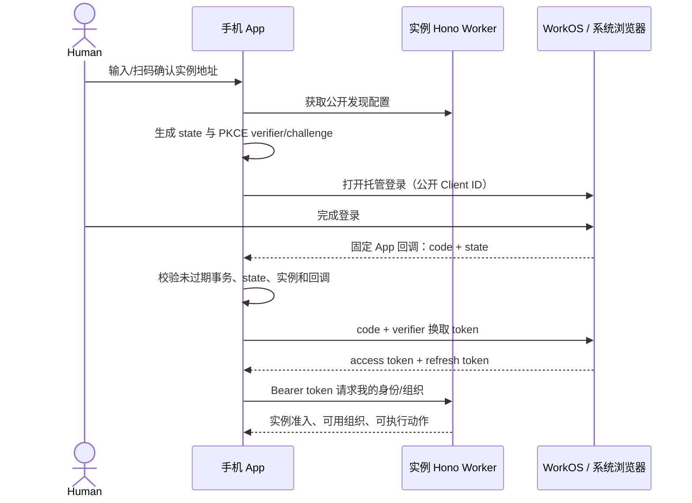

# T1 展开：仓库、自部署、手机与 CLI 登录

日期：2026-10-17。状态：Human 已认可的细化方案；TOB 公开规划仓库与任务迁移已获授权，未实现、未部署。

关联：[Spec #1](https://github.com/BotHarness/tob/issues/1)、[T1 #2](https://github.com/BotHarness/tob/issues/2)。本次仅收敛 T1，不扩大 T2–T5。

## 1. 要确认的结果

部署者使用自己的 Cloudflare 和 WorkOS。手机没有任何已配对 Host，输入实例地址后登录、创建自己的组织；CLI 登录同一身份，看到同一组织。两边退出、刷新、组织切换和失权均可验证。

推荐手机采用 AuthKit Authorization Code + PKCE，CLI 采用 AuthKit Device Authorization。登录直接连接 WorkOS，业务访问 Hono Worker。无需 Auth DO、应用密码表或自行签发第二种 Human 会话。

手机 PKCE 有 [WorkOS 官方 Expo 示例](https://github.com/workos/expo-authkit-example)；[Device Authorization](https://workos.com/docs/authkit/cli-auth)也可用于手机，但多一次验证码确认/返回 App 操作，保留为候选而非首片同时交付两种登录方式。两者均不需要客户端携带服务端 API key。

## 2. 新仓库组织

项目名 TOB — Thousands of Bots，仓库 `BotHarness/tob`。CLI 拟名 `tob`；npm scope 和许可证尚未正式确定。以下是建议目录，不代表已存在或开始创建。

```text
tob/
  apps/
    service/             Hono Worker、身份适配、应用命令、Org DO
      src/
      db/d1/             Drizzle schema 与 D1 SQL migrations
      db/org/            Drizzle schema 与 Org DO migrations
      wrangler.jsonc     资源 bindings、兼容日期、环境、定时任务
    cli/                 面向用户/管理员的薄 HTTP 客户端
  packages/
    contracts/           请求、响应、错误码、公开发现文档与协议版本
    client/              平台无关客户端；会话/安全存储通过平台适配
  tools/deployment/      部署、诊断、受保护的超级管理员初始化/恢复
  tests/                 公开合同和真实 Worker/D1/DO 集成测试
  docs/                  部署说明、协议、架构、ADR、验收操作
```

- T2 增加 Channel DO 与群消息合同；T3 增加独立参考 Agent。T1 不提前建立未使用的 Agent SDK、计费包或文件服务。
- 现有 DeepSeekBot 仓库继续拥有 Expo App、桌面入口、Host 适配和本地 Bot CLI。不搬迁产品，也不在新仓库提供聊天 Web UI。
- Forge 在这里是“一套服务端命令/校验合同，多入口消费”的组织原则。以现有 links 服务的单一 OpenAPI 合同先例为参考，不假定引入一个名为 Forge 的运行时依赖。
- Hono 路由执行应用命令与权限检查；CLI、手机调用同一 API。Hono RPC 服务 TypeScript 调用，OpenAPI/JSON 为其他语言提供公开合同；避免让外部 Agent 导入服务器包或依赖 Hono 才能访问。
- Drizzle 的 D1 与 DO schema/迁移分别归各自 owner；不把它们当成一个可以跨库 join/transaction 的数据库。官方分别提供 [D1](https://orm.drizzle.team/docs/sqlite/connect-cloudflare-d1)和 [DO SQLite](https://orm.drizzle.team/docs/sqlite/connect-cloudflare-do)驱动。锁定实际验证版本，不把当前文档推荐的 RC 自动当作项目升级决定。

## 3. 自部署资源清单

| 平台 | T1 需要 | 作用 |
| --- | --- | --- |
| Cloudflare | 一个 Worker | Hono API、公开实例信息、身份事件接收、定时补漏、组织管理 |
| Cloudflare | 一个 D1 database | 实例政策、超级管理员、组织映射、管理操作、事件收件记录和补漏进度 |
| Cloudflare | 一个 Org DO namespace，SQLite backend | 按 org_id 创建组织业务状态与只读身份投影；不是每组织手动配置一个 binding |
| Cloudflare | HTTPS 地址 | 可先用 workers.dev；自定义域名可选，API 与登录发现需保持稳定 origin |
| Cloudflare | Worker Secrets | WorkOS API key、事件签名校验 secret；不放源码或 App |
| Cloudflare | Cron Trigger + Worker 日志 | 有界补漏/重试、同步健康；事件处理与 checkpoint 持久化，日志去除令牌/认证码 |
| WorkOS | 部署者自己的项目/环境，T1 一个 AuthKit application | 该实例用户、会话、组织、成员；开发与生产环境隔离 |
| WorkOS | 公共 Client ID、托管登录域名、服务端 API key | App/CLI 只拿公开配置；API key 留在 Worker |
| WorkOS | 登录方式、移动回调白名单、Sign-out URI | 首片一种托管登录方式，沿用 spec 的邮箱密码建议；完整 OTP/Google 后续 |
| WorkOS | 身份事件端点及签名 secret | 发往本实例 Worker；Events API 补漏，同步资格变化 |

T1 不需要 R2、KV、Queues、Cloudflare Tunnel、Cloudflare Access 或邮件发送服务。T2 才增加 Channel DO namespace；R2 在附件切片增加。Cron 与 D1 inbox 足够首片的低频身份事件恢复，暂不增加另一种队列资源。

Cloudflare 资源通过 [bindings](https://developers.cloudflare.com/workers/runtime-apis/bindings/)连接；秘密使用 [Worker Secrets](https://developers.cloudflare.com/workers/configuration/secrets/)，补漏可使用 [Cron Triggers](https://developers.cloudflare.com/workers/configuration/cron-triggers/)。本方案建议以 Wrangler 配置和部署说明起步；一键部署按钮后续可减少 Cloudflare 设置，但不能替代部署者的 WorkOS 账号配置。

WorkOS 自部署模式意味着“业务运行在自己的 Cloudflare，身份仍在 WorkOS 云端”，不等于离线自托管 WorkOS。每个部署使用独立环境/凭证，不能共用 DSB 官方身份库。[WorkOS 自部署说明](https://workos.com/docs/on-prem-deployment)

### 配置归属

下列是建议配置合同，名字在实现时统一：

| 类别 | 内容 | 放在哪里 |
| --- | --- | --- |
| 公共实例配置 | INSTANCE_ID、PUBLIC_BASE_URL、协议版本 | Worker vars / 公开发现文档 |
| 公共认证配置 | WORKOS_CLIENT_ID、受支持 issuer/AuthKit domain、固定移动回调 | Worker vars / 公开发现文档 |
| 服务端秘密 | WORKOS_API_KEY、WORKOS_WEBHOOK_SECRET | Worker Secrets |
| 应用政策 | 注册准入、建组织政策、配置版本 | D1；部署参数只初始化默认值，不能每次部署覆盖管理员修改 |
| 资源绑定 | D1 的 INSTANCE_DB、Org DO 的 ORGS | Wrangler 配置，不需要把数据库密钥交给手机 |
| 部署权限 | Cloudflare deploy 凭证 | 部署者机器/CI，不进入业务 App 或普通 CLI 登录配置 |
| 用户凭证 | Access/refresh token | 手机安全存储、CLI OS 凭证库或明确配置的受限文件存储 |

WorkOS OAuth 设置不假定能靠我们的环境变量自动创建：Google 后续仍需在 WorkOS/provider 完成真实接入配置。T1 保持一个 application 服务手机与 CLI；日后要独立会话策略可拆 application，但保留同一环境的用户/组织。[WorkOS Applications](https://workos.com/docs/authkit/applications)

## 4. 部署者的最短操作路径

1. 获取开源仓库，准备自己的 Cloudflare 账号和 WorkOS 环境，选定公开 HTTPS 地址。
2. 在 WorkOS 设置一种登录方式、关闭不需要的开放注册，建立首个部署者用户；可通过 Dashboard 的账号/邀请能力完成首次准备，不要求应用先实现完整邀请 UI。
3. 登记发布版 App 的精确回调 URI；开发构建使用单独回调。登记固定 Sign-out URI，配置身份事件接收地址。
4. 部署工具创建 Worker/D1/Org DO binding，应用迁移，注入 Worker Secrets，配置 Cron；staging 和 production 分开。
5. 部署者通过受 Cloudflare 账号权限保护的初始化命令，将核验过的 WorkOS user_id 写入 instance_admin。这个命令不是匿名公网“第一个登录者成为管理员”。重复初始化须幂等；恢复另用显式恢复动作并记录审计。
6. 普通 CLI 执行 doctor：检查实例版本、绑定/迁移、公开认证配置与事件同步状态；诊断不回显秘密。
7. 手机和 CLI 分别登录，用业务 API 创建并查看组织。此后日常管理走普通账号权限，不需要部署凭证。

初始化工具的实现建议是部署者本机通过 Cloudflare 管理面执行受限 D1 初始化，并核验 WorkOS 用户；它与普通 `tob` 远程业务命令的权限明确分开。恢复实例管理员资格不能恢复/绕过 WorkOS 用户账号认证。

## 5. 连接发现与手机登录

公开发现端点建议为 `GET /.well-known/open-cloud-groups`。路径是我们的应用协议设计，不是 WorkOS 标准端点。返回实例 ID、服务地址、协议兼容范围、公共 Client ID、认证服务信息和支持能力；绝不返回 API key、组织名单或用户数据。

手机扫码只填入 HTTPS 实例地址，界面展示域名并让用户确认。二维码不携带长期密钥、用户身份或登录资格。发现信息固定在本次登录事务里，不能在回调时根据外部 URL 参数随意更换实例。



推荐回调形状为 `deepseekbot://cloud-auth/callback`，开发构建使用 `deepseekbot-dev://cloud-auth/callback`；这是待确认的路由合同。当前 App 已声明这两个 scheme，但尚无本云登录回调实现。每个自部署者把同一发布版回调登记在自己的 WorkOS application，运行时 Client ID 从实例读取，因此无须逐实例重新构建 App。

手机通过系统浏览器登录，密码只提交到 WorkOS 页面。PKCE 的作用是让拿到回调 code 的另一程序也不能仅凭 code 换取登录凭证。还须生成随机 state，并把实例 origin、Client ID、回调 URI、verifier、过期时间绑定为一次性事务；重复回调、切换实例后的旧回调都拒绝。自定义 scheme 不等于系统保证独占，不能省略这些校验。

公开发现允许的认证协议/服务域名必须校验，不能成为任意 token 转发器；令牌只发送到其绑定的实例和认证端点。T1 可先固定 WorkOS 官方 API 与已配置 AuthKit 域名，额外代理/通用 OIDC 留后续。实例改变 Client ID/issuer 时需重新确认和登录。

Native OAuth 必须在实际开发/发布构建验证，不能以 Expo Go 或网页预览替代。官方示例证明原生路线存在，不证明我们的 SDK 57、多实例缓存、冷启动回调已通过。SDK 与 Expo AuthSession/HTTP 的具体选择在 T1 开始后结合当前依赖验证；不为复刻示例随意引入 Node SDK/native crypto。

## 6. CLI 登录

拟定命令体验（尚未实现）：`tob login --server <HTTPS 地址>` → 显示实例与确认码 → 打开 WorkOS 页面确认 → CLI 登录成功；无浏览器机器可以在另一台设备打开验证码页面。

1. 与手机读取同一发现文档，锁定服务 origin 和 Client ID。
2. 调用 WorkOS device authorization，获得用户码、私有 device_code、验证地址、到期时间与轮询间隔。
3. 终端只展示用户确认码与验证地址；device_code 不输出。用户在浏览器核对验证码、登录并授权。
4. CLI 按 WorkOS 给定间隔等待结果，处理 slow_down、取消、超时；获取 token 后按实例/身份保存。
5. 调用同一 `/me` 与组织 API；`whoami`、`org list/create/use` 与手机具有相同权限。

CLI 不要求本机端口回调，也不复制用户密码。具体 device/refresh 合同按 [CLI Auth 官方文档](https://workos.com/docs/authkit/cli-auth)。普通 stdout 输出结构化结果，不输出 token；交互提示/验证码使用明确的交互输出，诊断与日志不能收集登录材料。

## 7. 登录后如何创建组织

用户最初可以已登录但没有任何组织。`/me` 返回这个事实以及是否允许创建，而不是因为缺少 org_id 就让所有入口 401。

手机“创建工作区”和 CLI `org create` 走同一服务命令：

1. Worker 验证真实 Human、实例准入与建组织政策；客户端提交的名称不赋予权限。
2. D1 记录稳定 operation_id 和 payload hash；相同操作重试恢复同一流程。
3. WorkOS 创建 Organization 和创建者的 owner membership；D1 建立唯一 organization_link。
4. 初始化该 org_id 的 Org DO（组织设置、成员资格只读投影）。全部必要步骤完成后标 active，才能作为可用组织返回。
5. 客户端通过 WorkOS 刷新/选择组织获得相应 org_id 的访问令牌，再访问组织业务 API；服务器核对 token 与目标组织。

原生/CLI 每个会话单独拥有 refresh token；同一用户不共享设备 refresh token。组织切换的 WorkOS 机制见[会话文档](https://workos.com/docs/authkit/sessions)。登录成功、被实例接纳、组织成员资格、建组织资格是不同判断。

跨 WorkOS/D1/Org DO 没有事务。创建接口的具体幂等/外部 ID 合同仍须 T1 实测；响应丢失后无法确认是否已创建时保持 processing/needs-review，并查证原资源，不盲目再次 create。T1 必须证明中途失败不会产生重复可用组织。

T1 落库沿用 spec 的六张 D1 表；Org DO 先落 org_config 和 member_access_projection。channel_directory、identity_delivery 与 Channel 全部表随 T2 增加，不提前实现空壳聊天层。

## 8. 刷新、退出、撤销

- 手机安全存储与 CLI 凭证存储按实例、Client ID、user_id 隔离；同一会话刷新串行，并原子替换返回的新 refresh token。
- 网络错误/临时服务错误只进入待重试状态；明确失效后才重新登录，不把断网当作撤销。[WorkOS Session resilience](https://workos.com/docs/authkit/session-resilience)
- 退出清理本机 token/cache；通过受验证的当前 sid 请求撤销自己的 WorkOS session，或走官方登出流程。远程撤销失败需明确“本机已退出，服务端撤销未确认”；不会撤销同用户其他设备会话。
- Worker 使用部署时可信 issuer/JWKS/Client ID 规则验签，不能相信请求方提供的验证地址。详细 claims 以实际 WorkOS 环境为准，不能假设所有 token 都有同样的 aud 字段。
- 验签不意味着实时查到撤销。签名事件入 D1，补漏/重试更新 Org DO 权限投影。T1 测量失效窗口，组织管理等敏感操作以权威状态确认，无法确认时暂拒绝；T2 再覆盖现有 WebSocket 撤权。事件机制依据 [WorkOS Events](https://workos.com/docs/events)。

## 9. T1 验收与后续确认

一次现场验收应能完成：新环境部署并初始化 → 无 Host 手机连地址 → 系统浏览器登录回 App → 创建组织 → CLI 独立登录看到同一组织 → 两边刷新/重启 → 切换第二个测试组织 → 退出一端不退出另一端 → 删除成员/撤销会话后请求被拒绝。

附带反例：不受邀身份不能因认证成功而加入实例；其他 WorkOS 环境 token 不能进入本实例；旧回调不能串号；操作重试不重复建组织；身份事件重复/乱序/暂失不恢复已撤权限。

目前仅核对文档、现有配置及任务，未完成任何新运行时集成。实际待证据项：WorkOS staging 原生 PKCE、CLI 授权、公共客户端刷新/组织切换、JWT claims、事件覆盖/时延、WorkOS 创建资源幂等与本项目 Drizzle 迁移。部署/真机 QA 在获准启动后执行。

已认可的设计方向：采用以上仓库边界；T1 仅 Worker + D1 + Org DO；手机 PKCE、CLI device flow；同一实例的一个 WorkOS application；首个管理员由部署者绑定明确 user_id。确认设计不等于启动实施。
