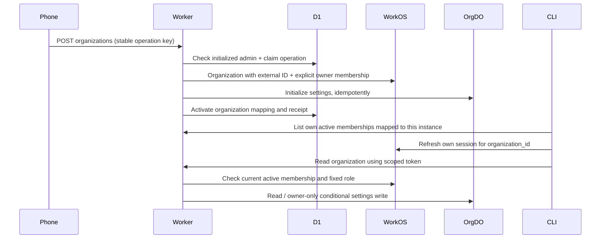

# T1 organization tracer bullet

Scope: a mobile user creates a workspace, their independent CLI lists and selects that exact organization, then both clients observe current owner/member authorization. UAT only; T2 messaging, invitations, role editors and Prod are not included.

## Authority and request path

WorkOS owns identity/membership. D1 `organization_link` holds the instance mapping and lifecycle; `management_operation` holds creation progress. `Org` owns name/description/version and a rebuildable membership observation. The observation is never used as an offline permission grant. No shared D1 permission cache or new Human session store.

All requests first require the originally initialized active instance administrator and fixed `admin_only` policies. Organization lists intersect current memberships with active mappings. Reads require a selected-org token and active owner/member membership; writes additionally require current owner. A stale owner JWT, unknown role, multiple roles, inactive membership, another instance's organization or provider outage cannot authorize a write. Instance administrator does not imply organization owner. The T1 single-admin boundary is unchanged.

For the live permission check, use the same initialized user and change **only the newly created test organization's membership** through the authorized UAT control plane: owner → member → owner. This checks role boundaries without admitting a new instance user or changing the original administrator binding. Restore that test membership after checks. Live deactivation is a separate unexecuted gate; automatic approval review did not authorize it in this run. No role-management API/UI is added to TOB.

## API / CLI

| API | CLI | Access |
| --- | --- | --- |
| `GET /api/organizations?after=...` | `org list --server URL [--after CURSOR]` | Active mapped memberships; 100 memberships per page |
| `POST /api/organizations` | `org create --server URL --name NAME --operation KEY` | Initialized administrator; body only `name`, 16–100 character stable `Idempotency-Key` |
| `GET /api/organizations/:id/access` | Selection preflight | Current membership; no org content |
| `GET /api/organizations/:id` | `org use --server URL --id ID`, `org show --server URL` | WorkOS org-scoped token + current membership |
| `PATCH /api/organizations/:id` | `org update --server URL --description TEXT --version N` | Owner, description ≤500 chars, matching settings version |

`org use` preflights access, refreshes its own WorkOS session with `organization_id`, persists rotated tokens and verifies the signed `org_id` before reading. It does not change another client's selected organization or refresh token. Mobile selection follows the same production token endpoint; the Worker verifies scope. Cold start restores saved credentials but shows no verified organization until checked again. Client discovery checks and instance/session isolation remain in force.

Mobile shows workspaces under Cloud services. Creation stores the request key and name in its secure vault before sending; retry after network loss/app restart uses the same request. Pending creation blocks renaming that request. Uncertain server state is visible instead of a success notification. CLI callers retain/reuse their explicit operation key. Logout/config replacement deliberately clears local pending state with the session; reconcile any uncertain server operation before starting another create.

## Recovery and migration

Creation uses one winning D1 insert, a stable WorkOS external ID, one conditional membership-create claim and a final D1 batch. Replays read WorkOS by the same external ID and never blindly issue another create. If an external write may not have happened and a read cannot establish it, return `OPERATION_RECONCILIATION_REQUIRED`; an operator must inspect that operation. No timed lock takeover, role escalation or automatic cleanup of external resources. A returned member role cannot be upgraded by retrying creation.

D1 migration adds `organization_link`; Org SQLite adds settings fields and `member_access_projection`. Existing rows/columns remain. DO initialization cannot overwrite settings. Version-conditional description updates refuse stale writers. Reverting the Worker does not undo created WorkOS organizations or database data; retain records and reconcile forward. The earlier SQLite schema remains readable by the previous Worker.

The UAT role setup creates `owner` with no provider-wide permissions, retaining member as default and single-role mode. Current runtime role slugs are strict owner/member; control-plane role configuration is independently read back before live testing. No implicit mapping from WorkOS's built-in `admin` role.

## Acceptance and evidence boundaries

- Local workerd: signed JWT admission; one organization across concurrency/replay; response-loss reconciliation after organization/membership creation; real D1/DO persistence/eviction; stale settings rejection; scoped token; owner/member/inactive/unknown/multiple-role denial.
- CLI: real signed fixture login/refresh, organization selection through WorkOS token endpoint, independent credentials and server refusal propagation.
- Mobile source: create/select/update/restart; stable request across lost response; member denial; mismatched response refusal.
- Real UAT + assigned Simulator: mobile create/owner save → independent CLI same-ID list/select/read, stale-owner denial after member downgrade, readonly view, restored owner, cold restart and logout isolation passed. API-prepared test authentication is distinct from Hosted AuthKit browser acceptance already recorded in #2103.
- Physical camera/phone, Android, remaining accessibility, signed identity webhooks/reconciliation and final Human review remain separate T1 gates.

Official references: [WorkOS Organizations](https://workos.com/docs/reference/organization), [membership API](https://workos.com/docs/reference/authkit/organization-membership), [switching organizations](https://workos.com/docs/authkit/sessions#switching-organizations), [Durable Objects rules](https://developers.cloudflare.com/durable-objects/best-practices/rules-of-durable-objects/).

## Live UAT evidence — 2026-10-18 JST

Deployed Worker `e5bc56298c2f63aa457ba39a1ce9ad45e2270824`, version `d492f524-3489-4f97-b300-ec1e8671752e`; D1 migration and Org DO schema probe passed. Review head `fe5a8cb` adds tests only. WorkOS owner role was created with no provider-wide permissions; member remains default in single-role mode. Existing admin binding was not changed.

Phone created one synthetic organization through its actual UI, became owner, and saved description/version 2. Formal independent CLI listed, selected and read the exact same ID/content/version. After temporary member downgrade, both the stale-owner CLI credential and phone UI received 403 `ORGANIZATION_OWNER_REQUIRED`; original data remained unchanged. Restored active owner and read back from control plane, CLI and phone. Mobile cold restart revalidated the same selection; logout revoked only its session and rejected its latest refresh token while CLI stayed admitted. Registration/Magic Auth both read back disabled.

The first phone run exposed stale unsaved text/list role after reselection; fixed and repeated at mobile runtime `1b39324c5034eea2741abed62d579cd1044f2f86`. Create/save footage is at preceding `494a20f1e`; only the later selection/display behavior changed. [Mobile Draft #2121](https://github.com/BotHarness/DeepSeekBot/pull/2121) carries screenshots, recordings and the bounded report. No merge or Prod changes.

Local checks: 20 workerd + 19 Node/CLI/contracts + 2 wizard tests, typecheck/build passed. A repeated workerd run under concurrent native compilation hit the default 5-second timeout; the same assertions passed with a 20-second timeout. This is recorded as a timing failure/retry, not a new production guarantee.

Automatic approval review rejected optional second-org creation and real membership deactivation as beyond this requested slice; neither executed. Switching here means unscoped session → the same phone-created organization, not a demonstrated two-organization switch. Inactive-role, provider-outage and response-loss recovery remain local-test evidence only. Signed identity events/reconciliation, live revocation propagation/configuration interruption recovery, remaining physical/platform acceptance and Human review still block full T1 closure.

## Subsequent authorized collaboration slices

The earlier single-admin/single-organization evidence above remains historical. The Human subsequently authorized ordinary-user default/multiple workspaces and multi-user invitations: [current scope and evidence](multi-user-collaboration.md). The [organization invitation continuation](organization-invitations.md#native-uat-continuation--2026-10-18-jst) verifies native A→B membership and current owner/member permission boundaries. It does not close the remaining T1 identity-event, same-membership reactivation, deployment-recovery or platform/Human acceptance gates.
